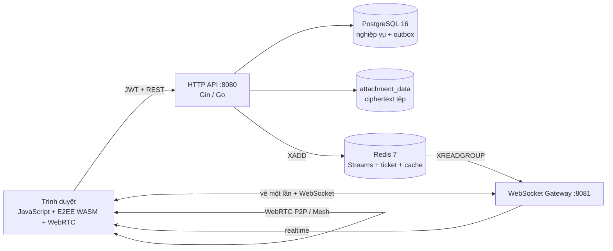
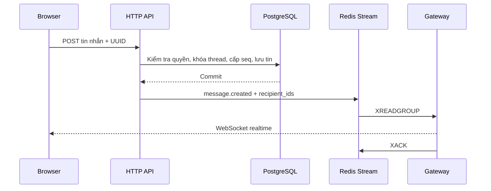

# Mini Hermes

Mini Hermes là ứng dụng nhắn tin thời gian thực gồm chat cá nhân, chat nhóm, gửi tệp, thu hồi tin nhắn và gọi thoại/video 1–1 hoặc theo nhóm. Backend viết bằng Go; PostgreSQL lưu dữ liệu nghiệp vụ; Redis Streams vận chuyển sự kiện tới WebSocket Gateway; giao diện dùng HTML, CSS và JavaScript thuần. Chat cá nhân và tệp đính kèm sử dụng mã hóa đầu cuối tại trình duyệt qua Go WebAssembly.

## Kiến trúc hệ thống



### Các thành phần

| Thành phần | Trách nhiệm |
| --- | --- |
| Web client | Giao diện, cache hội thoại, E2EE, attachment, WebSocket và WebRTC. Mã hóa/giải mã diễn ra tại trình duyệt. |
| HTTP API | Xác thực JWT, kiểm tra quyền, transaction PostgreSQL, upload/download ciphertext, quản lý cuộc gọi và xác thực signaling. |
| WebSocket Gateway | Xác thực bằng vé dùng một lần, đọc Redis Stream và định tuyến sự kiện tới các kết nối của đúng người nhận. Không xử lý media. |
| PostgreSQL | Nguồn dữ liệu chuẩn cho tài khoản, hội thoại, tin nhắn, khóa E2EE, attachment, thu hồi và cuộc gọi. |
| Redis | Event bus API → Gateway, cache membership và vé WebSocket ngắn hạn; không phải nơi lưu lịch sử chuẩn. |
| Attachment volume | Lưu ciphertext của tệp; metadata và quyền truy cập nằm trong PostgreSQL. |
| Migration container | Chạy Goose trước API/Gateway để cập nhật schema. |

### Luồng tin nhắn và realtime



- PostgreSQL được ghi trước khi phát realtime.
- UUID do client tạo giúp retry không sinh tin trùng; `seq` quyết định thứ tự trong từng thread.
- Khi WebSocket gián đoạn, client lấy bù lịch sử qua REST.
- Thu hồi giữ ID/vị trí nhưng xóa payload cũ khỏi dữ liệu phục vụ; thiết bị offline đồng bộ qua cursor thay đổi.

### Xác thực và bảo mật

- Mật khẩu gốc không gửi tới backend. Browser dùng Argon2id và HKDF để tạo credential cùng khóa mở vault.
- Server lưu hash credential; JWT xác định actor bằng claim `sub`, không tin `sender_id` trong body.
- WebSocket dùng vé một lần, mặc định hết hạn sau 30 giây và được tiêu thụ nguyên tử trong Redis.
- Chat cá nhân dùng X3DH và AES-256-GCM. Private key nằm trong vault mã hóa; khóa phiên có backup mã hóa.
- Tệp direct được mã hóa tại browser; server và volume chỉ nhận ciphertext.
- Download luôn kiểm tra membership, thu hồi, hạn dùng và trạng thái xóa.
- Signaling cuộc gọi đi qua API có JWT; backend kiểm tra người gọi, phòng và session nguồn/đích.
- Production phải thay secret mặc định, dùng HTTPS/WSS và cấu hình TURN.

### Dữ liệu và vị trí lưu

| Nhóm | Bảng/chỗ lưu | Nội dung |
| --- | --- | --- |
| Tài khoản | `users`, `prekeys` | Username, credential hash, KDF, public bundle, vault mã hóa và prekey. |
| Hội thoại | `threads`, `participants` | Direct/group, role, khoảng membership, read marker và sequence. |
| Tin nhắn | `messages`, `message_change_events` | Text/system, envelope E2EE, metadata, recall và cursor thay đổi. |
| Tệp | `attachments` + volume `attachment_data` | Metadata/quyền trong DB; ciphertext vật lý trong volume. |
| E2EE | `e2ee_epochs`, `e2ee_epoch_backups` | Bootstrap và backup khóa phiên mã hóa. |
| Gọi 1–1 | `calls`, `active_call_users`, `call_events` | Trạng thái, busy lock và outbox. |
| Gọi nhóm | `group_calls`, `group_call_sessions`, `group_call_events` | Phòng, session thiết bị, version và outbox. |

### Cấu trúc mã nguồn

```text
Project_IT4409/
├── cmd/
│   ├── main.go                    # HTTP API
│   ├── ws-gateway/                # WebSocket Gateway
│   └── e2ee-wasm/                 # entrypoint Go/WASM
├── config/                        # cấu hình mẫu
├── db/
│   ├── migrations/                # migration Goose
│   └── queries/                   # truy vấn sqlc
├── internal/
│   ├── database/sqlc/             # mã truy vấn được sinh
│   ├── e2ee/                      # X3DH, AES-GCM, vault, epoch
│   ├── gateway/                   # Redis consumer và WebSocket hub
│   ├── middleware/                # Bearer JWT
│   ├── module/
│   │   ├── attachment/            # upload/download/cleanup
│   │   ├── call/                  # gọi 1–1 và nhóm
│   │   ├── e2ee/                  # bundle/epoch/backup
│   │   ├── message/               # gửi/lịch sử/thu hồi/outbox
│   │   ├── thread/                # direct/group/membership/read
│   │   └── user/                  # đăng ký/đăng nhập
│   ├── route/                     # Gin router và integration test
│   ├── token/                     # JWT HS256
│   └── wsticket/                  # vé WebSocket một lần
├── web/                           # UI, realtime, E2EE và WebRTC
├── docs/                          # kiến trúc, ERD, ADR
├── Dockerfile
└── docker-compose.yml
```

### Công nghệ và thư viện

| Công nghệ | Vai trò |
| --- | --- |
| Go 1.27 | API, Gateway, worker và E2EE/WASM. |
| Gin | Router, middleware, JSON và multipart API. |
| pgx v5 / PostgreSQL 16 | Query, transaction, constraint và transactional outbox. |
| go-redis v9 / Redis 7 | Streams, cache membership và WS ticket. |
| coder/websocket | WebSocket, heartbeat và dispatch. |
| google/uuid | Public ID, request/session/device ID. |
| libsignal, x/crypto | X3DH, Argon2id, HKDF và primitive mật mã. |
| Go WebAssembly | Chạy E2EE Go trong browser. |
| WebRTC API | Media P2P 1–1 và Mesh tối đa 4 người. |
| Goose | Migration trong container `migrate`. |
| Docker Compose | Chạy toàn bộ hệ thống. |

## Chạy dự án bằng Docker

Chỉ cần Docker Desktop có Docker Compose v2. Không cần cài riêng Go, PostgreSQL, Redis, Node.js, Goose hoặc Make. Lần build đầu cần Internet để tải image và Go module.

```powershell
Set-Location 'D:\DATA\Visual\Project_IT4409'
docker compose up -d --build
```

Địa chỉ:

- Landing: `http://localhost:8080`
- Đăng nhập: `http://localhost:8080/login`
- Ứng dụng: `http://localhost:8080/app`
- Gateway: `ws://localhost:8081/ws`

Khởi động lại không build:

```powershell
docker compose up -d
```

Dừng và giữ dữ liệu:

```powershell
docker compose down
```

Xóa cả PostgreSQL và attachment volume:

```powershell
docker compose down -v
```

> `down -v` xóa dữ liệu không thể phục hồi từ Docker volume.

Đặt JWT secret riêng:

```powershell
$env:MINI_HERMES_JWT_SECRET = 'mot-secret-ngau-nhien-dai-va-khong-cong-khai'
docker compose up -d --build
```

API và Gateway phải dùng cùng secret. Ngoài localhost cần HTTPS, WSS, origin phù hợp và TURN server.

## HTTP API

Trừ health và auth, endpoint nghiệp vụ yêu cầu `Authorization: Bearer <access_token>`.

### Xác thực và realtime

| Method | Endpoint | Chức năng |
| --- | --- | --- |
| `GET` | `/health` | Health check. |
| `GET` | `/auth/params?username=...` | KDF profile công khai. |
| `POST` | `/auth/register` | Đăng ký cùng credential, bundle và vault. |
| `POST` | `/auth/login` | Đăng nhập và trả JWT. |
| `POST` | `/auth/ws-ticket` | Vé WebSocket dùng một lần. |
| `GET` | `/users` | Danh sách người dùng. |

### Hội thoại, tin nhắn và tệp

| Method | Endpoint | Chức năng |
| --- | --- | --- |
| `POST` | `/threads/direct` | Tạo/mở chat cá nhân. |
| `POST` | `/threads/group` | Tạo nhóm. |
| `GET` | `/threads` | Danh sách hội thoại và unread. |
| `GET/POST` | `/threads/:id/members` | Xem/thêm thành viên. |
| `DELETE` | `/threads/:id/members/:user_id` | Xóa thành viên. |
| `POST` | `/threads/:id/leave` | Rời nhóm. |
| `GET/POST` | `/threads/:id/messages` | Lịch sử/gửi tin. |
| `PUT` | `/threads/:id/read` | Cập nhật read marker. |
| `POST` | `/messages/:id/recall` | Thu hồi tin của actor. |
| `GET` | `/message-changes` | Đồng bộ thay đổi theo cursor. |
| `POST` | `/threads/:id/attachments` | Upload ciphertext tối đa 20 MiB + tag. |
| `GET` | `/attachments/:id/content` | Download có kiểm tra quyền. |

### E2EE

| Method | Endpoint | Chức năng |
| --- | --- | --- |
| `GET` | `/e2ee/account` | Vault và public bundle của actor. |
| `POST` | `/e2ee/bundles/:user_id/claim` | Claim prekey peer. |
| `GET/POST` | `/threads/:id/epochs` | Đọc/tạo epoch. |
| `PUT` | `/threads/:id/epochs/:epoch_id/key` | Lưu backup khóa phiên. |

### Gọi 1–1

| Method | Endpoint | Chức năng |
| --- | --- | --- |
| `POST` | `/threads/:id/calls` | Tạo audio/video call. |
| `GET` | `/calls/:id` | Trạng thái call. |
| `POST` | `/calls/:id/accept` | Chấp nhận. |
| `POST` | `/calls/:id/reject` | Từ chối. |
| `POST` | `/calls/:id/connected` | Báo media đã kết nối. |
| `POST` | `/calls/:id/end` | Kết thúc/hủy. |
| `GET` | `/calls/:id/ice-config` | ICE servers. |
| `POST` | `/calls/:id/signal` | Offer/answer/ICE. |

### Gọi nhóm

| Method | Endpoint | Chức năng |
| --- | --- | --- |
| `POST` | `/threads/:id/group-calls` | Tạo/lấy phòng mở. |
| `GET` | `/threads/:id/group-calls/active` | Phòng hiện tại. |
| `GET` | `/group-calls/:id` | Snapshot phòng. |
| `POST` | `/group-calls/:id/join` | Tạo session `joining`. |
| `POST` | `/group-calls/:id/ready` | Chuyển sang `ready`. |
| `POST` | `/group-calls/:id/leave` | Rời phòng. |
| `POST` | `/group-calls/:id/end` | Creator kết thúc cho tất cả. |
| `POST` | `/group-calls/:id/signal` | Signaling tới session đích. |

Chi tiết xem [Kiến trúc gọi thoại và video](docs/calling-architecture.md).

## Kiểm tra

```powershell
docker compose ps
docker compose logs --tail 100 api gateway migrate
Invoke-RestMethod http://localhost:8080/health
```

Kết quả health mong đợi: `{"status":"ok"}`.

`Dockerfile` chạy `go test ./...` trước khi build binary. Chạy lại toàn bộ test bằng:

```powershell
docker compose build --no-cache api gateway
```

Kiểm tra thủ công:

1. Hai tài khoản gửi tin hai chiều, reload và kiểm tra lịch sử.
2. Ngắt mạng một bên rồi kết nối lại; client lấy bù mà không nhân đôi UUID.
3. Thu hồi text/emoji/attachment; payload cũ biến mất và download mới bị chặn.
4. Gọi 1–1 hai chiều rồi kết thúc; lịch sử có system message.
5. Cho 2–4 tài khoản gọi nhóm; người vào muộn kết nối được với peer hiện có.
6. Một người rời không đóng phòng; vào lại có session mới; người thứ 5 nhận `409`.
7. Kiểm tra Wi‑Fi/4G sau khi cấu hình TURN.

## Tài liệu

1. [Kiến trúc và luồng nghiệp vụ](docs/project-flows.md)
2. [Kiến trúc gọi thoại/video](docs/calling-architecture.md)
3. [ERD và ràng buộc dữ liệu](docs/chat-api-erd.md)
4. [ADR 001 — Gateway và Redis Stream](docs/adr/001-gateway-and-stream.md)
5. [ADR 002 — Unread và read marker](docs/adr/002-unread-count.md)
6. [ADR 003 — Thứ tự và retry](docs/adr/003-message-order.md)
7. [ADR 005 — E2EE có khả năng phục hồi](docs/adr/005-recoverable-e2ee-sessions.md)

## Giới hạn và lưu ý

- Gọi nhóm dùng Mesh tối đa 4 người; phòng lớn cần SFU như LiveKit, Janus hoặc mediasoup.
- Cấu hình hiện tại chỉ có STUN công cộng; production cần TURN với credential ngắn hạn.
- Gateway hiện phù hợp một consumer ổn định; scale ngang cần định tuyến connection ownership.
- Chat nhóm hiện là plaintext; E2EE áp dụng cho direct chat và attachment direct.
- Redis không phải nơi lưu lịch sử; PostgreSQL luôn là nguồn dữ liệu chuẩn.
- Secret mặc định trong Compose chỉ dành cho local.
- WebRTC cần secure context: localhost được phép, production phải dùng HTTPS/WSS.
