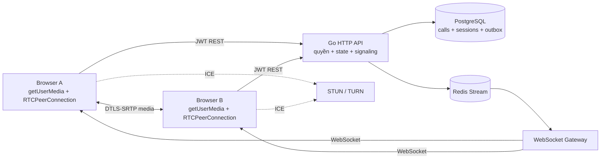
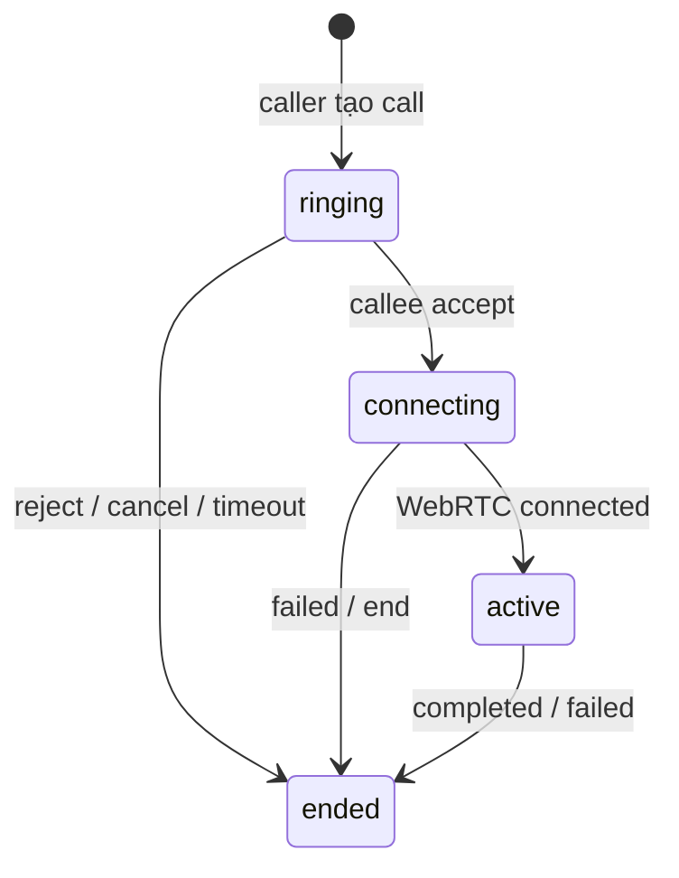
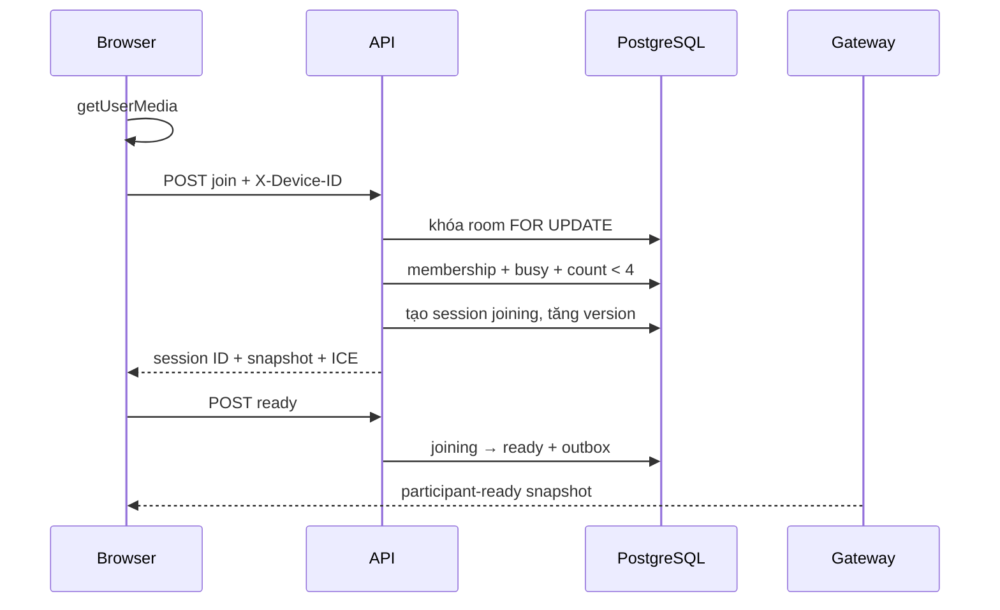

# Kiến trúc gọi thoại và gọi video

Tài liệu mô tả chức năng gọi thoại/video 1–1 và gọi nhóm của Mini Hermes: kiến trúc, thư viện, dữ liệu, API, signaling, WebRTC, bảo mật và giới hạn.

## 1. Kiến trúc tổng thể

Mini Hermes dùng WebRTC truyền audio/video trực tiếp giữa trình duyệt. Backend không giải mã hoặc chuyển tiếp media; backend quản lý quyền, trạng thái và signaling.



Ba lớp độc lập:

1. **Media plane:** audio/video mã hóa DTLS-SRTP truyền P2P; gọi nhóm dùng Mesh.
2. **Signaling plane:** SDP offer/answer và ICE đi qua HTTP API → Redis → Gateway → WebSocket.
3. **State plane:** quyền, trạng thái, timeout, session và outbox nằm trong PostgreSQL.

## 2. Công nghệ và thư viện

| Công nghệ | Vai trò |
| --- | --- |
| WebRTC Web API | `getUserMedia`, `MediaStream`, `RTCPeerConnection`, SDP và ICE. |
| JavaScript `Map` | Quản lý một peer state riêng cho từng remote session trong Mesh. |
| Gin | Endpoint tạo, accept, end, join, ready và signal. |
| pgx v5 | Transaction, khóa `FOR UPDATE` và snapshot PostgreSQL. |
| PostgreSQL | Call state, session, busy lock, version và transactional outbox. |
| go-redis v9 / Redis Streams | Vận chuyển sự kiện từ API tới Gateway. |
| coder/websocket | Kết nối realtime, heartbeat và dispatch. |
| google/uuid | Call ID, request ID, session ID và device ID. |
| Docker Compose | API, Gateway, PostgreSQL, Redis và migration. |

Không dùng thư viện WebRTC phía thứ ba; media sử dụng API chuẩn của trình duyệt.

## 3. Vị trí mã nguồn

| Tệp | Trách nhiệm |
| --- | --- |
| `internal/module/call/call.go` | Model/lỗi gọi 1–1. |
| `internal/module/call/repository.go` | State machine và transaction 1–1. |
| `internal/module/call/http.go` | HTTP handler, ICE, publisher và worker. |
| `internal/module/call/group.go` | Model phòng/participant nhóm. |
| `internal/module/call/group_repository.go` | Room/session, giới hạn 4, version và quyền signal. |
| `internal/module/call/group_http.go` | API nhóm và device binding. |
| `internal/gateway/consumer.go` | Decode call events từ Redis. |
| `internal/gateway/hub.go` | Dispatch tới connection của recipient. |
| `web/call-api.js` | REST client có JWT và `X-Device-ID`. |
| `web/call-manager.js` | Peer 1–1 và UI cuộc gọi. |
| `web/group-call-manager.js` | Mesh peers, snapshot/version và grid. |
| `db/migrations/20261021100000_create_calls.sql` | Schema 1–1. |
| `db/migrations/20261022100000_create_group_calls.sql` | Schema nhóm. |

## 4. Cuộc gọi 1–1

### 4.1 Dữ liệu và trạng thái

`calls` lưu caller, callee, thread, media type, request ID, thời điểm và trạng thái:



- `client_request_id` làm thao tác tạo có tính idempotent.
- `media_type` là `audio` hoặc `video`.
- `end_reason` là `completed`, `cancelled`, `rejected`, `missed` hoặc `failed`.
- `active_call_users` có `user_id` là khóa chính, ngăn một tài khoản ở hai cuộc gọi.
- `call_events` là outbox cho `call.invited`, `call.accepted`, `call.ended`.

Quyền:

- chỉ callee accept/reject khi `ringing`;
- offer ban đầu chỉ do caller gửi, answer chỉ do callee gửi;
- ICE hợp lệ khi `connecting` hoặc `active`;
- backend lấy actor từ JWT, không từ body.

### 4.2 Luồng kết nối

```mermaid
sequenceDiagram
    participant A as Caller
    participant API as API
    participant DB as PostgreSQL
    participant RG as Redis + Gateway
    participant B as Callee
    A->>API: POST /threads/:id/calls
    API->>DB: call + busy users + outbox
    RG-->>B: call.invited
    B->>B: xin mic/camera
    B->>API: POST /calls/:id/accept
    RG-->>A: call.accepted
    A->>A: createOffer + setLocalDescription
    A->>API: call.offer
    RG-->>B: offer
    B->>B: setRemoteDescription + createAnswer
    B->>API: call.answer
    RG-->>A: answer
    A->>API: ICE candidates
    B->>API: ICE candidates
    A <-->> B: audio/video DTLS-SRTP
    A->>API: POST /connected
```

ICE nhận trước `remoteDescription` được giữ trong `pendingIce`; chỉ gọi `addIceCandidate()` sau khi remote description đã tồn tại.

### 4.3 Kết thúc

Transaction kết thúc sẽ:

1. chuyển call sang `ended`;
2. giải phóng `active_call_users`;
3. tăng sequence của thread;
4. tạo system message;
5. ghi `call.ended` vào outbox.

Client nhận event, dừng track, đóng `RTCPeerConnection` và tải bù lịch sử để hiện thông báo.

## 5. Cuộc gọi nhóm Mesh

### 5.1 Mô hình Mesh và giới hạn

Mỗi participant tạo một peer connection với từng participant khác:

```text
số kết nối = n × (n - 1) / 2
```

| Người | Kết nối toàn phòng | Peer/thiết bị |
| --- | ---: | ---: |
| 2 | 1 | 1 |
| 3 | 3 | 2 |
| 4 | 6 | 3 |

Vì băng thông upload và CPU tăng theo số peer, bản hiện tại giới hạn 4 người. Phòng lớn nên dùng SFU.

### 5.2 Dữ liệu

`group_calls`:

- tối đa một phòng `open` cho mỗi group thread;
- creator có quyền kết thúc cho tất cả;
- lưu `audio`/`video`, `version`, `empty_since` và thời điểm kết thúc.

`group_call_sessions`:

- mỗi lần vào phòng có một session UUID mới;
- gắn user với `device_id` của tab;
- trạng thái `joining`, `ready`, `left`;
- partial unique index chặn hai session hoạt động của cùng user.

`group_call_events` là outbox cho:

```text
group-call.started
group-call.participant-ready
group-call.participant-left
group-call.ended
```

Signaling theo cặp:

```text
group-call.offer
group-call.answer
group-call.ice
```

### 5.3 Join và ready



Tách `join` và `ready` tránh offer đến khi client chưa có local media/session ID. Retry `ready` chỉ cập nhật `last_seen_at`, không tăng version hoặc phát event trùng.

Transaction join kiểm tra:

1. phòng còn mở;
2. actor còn là thành viên nhóm;
3. actor chưa ở cuộc gọi khác;
4. không có session hoạt động trên device khác;
5. tổng session `joining/ready` nhỏ hơn 4.

### 5.4 Peer manager

Một local stream được chia sẻ cho các peer:

```javascript
const peers = new Map();
// remoteSessionId -> {
//   pc: RTCPeerConnection,
//   pendingIce: [],
//   queue: Promise,
//   offerStarted: boolean,
//   closed: boolean
// }
```

Mỗi peer có queue tuần tự để SDP/ICE không chạy chồng nhau. Lỗi một cặp không đóng cả phòng.

Quy tắc tạo offer ban đầu:

```text
session ID nhỏ hơn theo thứ tự chuỗi tạo offer
```

Khi participant mới ready, client cập nhật snapshot, tạo peer, phía được chỉ định phát offer đúng một lần. Offer, answer và ICE chỉ gửi tới session còn lại của cặp.

### 5.5 Signaling và xác thực session

```json
{
  "type": "group-call.offer",
  "sourceSessionId": "session-a",
  "targetSessionId": "session-b",
  "payload": { "type": "offer", "sdp": "..." }
}
```

Backend kiểm tra:

- JWT actor sở hữu source session;
- `X-Device-ID` khớp session;
- source/target đều ready trong cùng phòng open;
- target user được lấy từ PostgreSQL;
- event type và kích thước payload hợp lệ.

API gắn `from_session_id`, `target_session_id` và recipient rồi ghi Redis. Gateway định tuyến theo user; trong các tab của user, chỉ tab có đúng target session xử lý.

### 5.6 Leave, rejoin và timeout

- Một người rời chỉ đóng peer của session đó; phòng tiếp tục.
- Không dừng local tracks khi chỉ remote peer rời.
- Rejoin tạo session mới để event cũ đến trễ không phục hồi peer cũ.
- Creator `end` sẽ đóng mọi session, giải phóng busy lock và tạo system message.
- Phòng trống được đánh dấu `empty_since` và worker đóng sau khoảng chờ.
- Session `joining` bị bỏ dở hết hạn để không chiếm chỗ mãi.

## 6. ICE, STUN và TURN

ICE có ba loại candidate: host, server-reflexive qua STUN và relay qua TURN. Cấu hình hiện tại chỉ trả:

```json
{"iceServers":[{"urls":["stun:stun.l.google.com:19302"]}]}
```

STUN không vượt được mọi NAT/firewall. Production cần TURN, ưu tiên credential ngắn hạn:

```json
{
  "iceServers": [
    { "urls": ["stun:turn.example.com:3478"] },
    {
      "urls": [
        "turn:turn.example.com:3478?transport=udp",
        "turns:turn.example.com:5349?transport=tcp"
      ],
      "username": "temporary-user",
      "credential": "temporary-secret"
    }
  ]
}
```

Nếu UI xuất hiện nhưng không có media, kiểm tra: quyền mic/camera → offer/answer → ICE candidates → `connectionState` → TURN.

## 7. Bảo mật

- WebRTC mã hóa media bằng DTLS-SRTP.
- JWT quyết định user; ID trong request không tự tạo quyền.
- API kiểm tra membership trước thao tác call.
- Busy lock và unique index chống tham gia đồng thời sai quy tắc.
- `FOR UPDATE` ngăn join đồng thời vượt 4 người.
- SDP/ICE chỉ cho phép đúng type và giới hạn kích thước.
- Device ID ràng buộc tab với actor JWT nhưng không thay thế xác thực tài khoản.
- Không log SDP, ICE candidate hoặc TURN credential ở production.
- Mã hóa đường truyền không ngăn người nhận ghi âm/quay màn hình.

## 8. Realtime và reconnect

- Event trạng thái bền vững dùng PostgreSQL outbox → Redis Stream → Gateway.
- Signaling là ngắn hạn; sau mất mạng client đối chiếu lại bằng REST snapshot.
- Gọi nhóm dùng `version`: bỏ event cũ; khi phát hiện thiếu version thì tải `GET /group-calls/:id`.
- ICE chờ được giới hạn và chỉ flush sau remote description.
- WebSocket reconnect kích hoạt `reconcile()` cho manager cuộc gọi.

## 9. Giao diện

Gọi 1–1 có màn hình đến, Nhận/Từ chối, remote media, local preview, trạng thái, thời lượng, Mic, Camera và Kết thúc.

Gọi nhóm có thẻ **Tham gia/Quay lại cuộc gọi** trong group chat. Một người dùng một ô; hai người dùng hai ô; 3–4 người dùng lưới 2×2. Mỗi ô có avatar/video, tên và trạng thái. Creator thấy **Kết thúc cho tất cả**; thành viên có **Rời cuộc gọi**. Thu nhỏ UI không đóng WebRTC.

## 10. HTTP API

### 1–1

```text
POST /threads/:threadId/calls
GET  /calls/:callId
POST /calls/:callId/accept
POST /calls/:callId/reject
POST /calls/:callId/connected
POST /calls/:callId/end
GET  /calls/:callId/ice-config
POST /calls/:callId/signal
```

### Nhóm

```text
POST /threads/:threadId/group-calls
GET  /threads/:threadId/group-calls/active
GET  /group-calls/:callId
POST /group-calls/:callId/join
POST /group-calls/:callId/ready
POST /group-calls/:callId/leave
POST /group-calls/:callId/end
POST /group-calls/:callId/signal
```

API nhóm liên quan session yêu cầu `X-Device-ID: <UUID của tab>`.

## 11. Kiểm thử cần thực hiện

### 1–1

1. Invite, accept, offer, answer và ICE tới đúng vai trò.
2. Hai bên nghe/thấy nhau; mic/camera chỉ thay đổi đúng track.
3. Reject, missed, cancel, failed và completed giải phóng busy lock.
4. Kết thúc tạo system message.

### Nhóm

1. A/B giao tiếp hai chiều.
2. C vào muộn và tạo đủ peer.
3. B rời nhưng A/C tiếp tục.
4. B rejoin với session mới.
5. Join đồng thời không tạo session trùng.
6. Người thứ 5 nhận `409`.
7. Retry ready không tăng version.
8. Signal sai session/phòng bị từ chối.
9. Creator kết thúc và mọi client dọn track/peer.
10. Kiểm tra Wi‑Fi/4G sau khi có TURN.

## 12. Giới hạn và hướng phát triển

- Chưa có SFU, screen sharing, recording hoặc nâng audio thành video giữa phiên.
- Chưa dùng perfect negotiation cho renegotiation và ICE restart nâng cao.
- Trạng thái mic/camera remote chưa được đồng bộ thành event riêng.
- Compose mặc định chưa có TURN.
- Một tài khoản chỉ có một device session hoạt động trong phòng.
- Scale nhiều Gateway cần định tuyến session/device xuyên instance.

Thứ tự mở rộng đề xuất: coturn → credential TURN ngắn hạn → heartbeat session → perfect negotiation/ICE restart → metrics `getStats()` → SFU cho phòng lớn.
