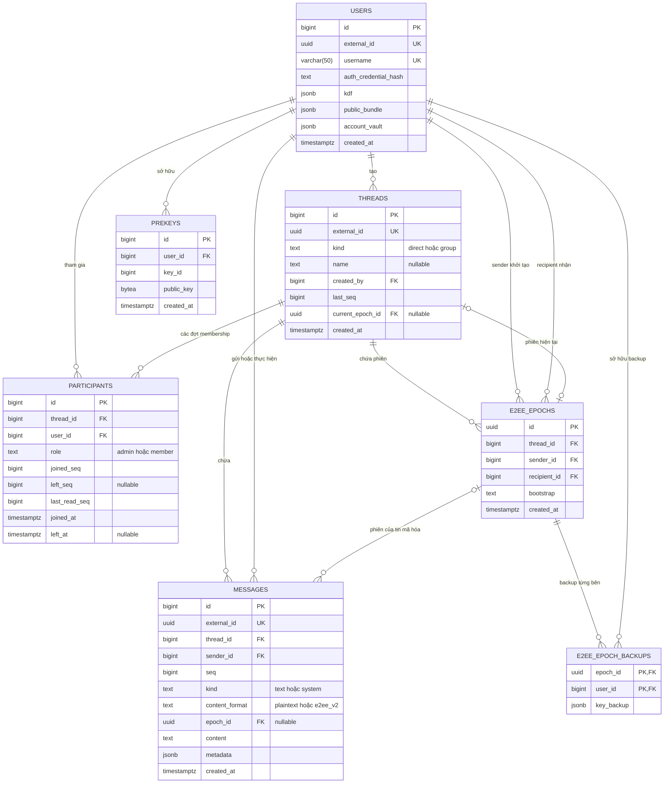

# ERD Mini-Hermes

Schema có bảy bảng nghiệp vụ sau migration `20261009100000`. API công khai dùng UUID; `BIGINT` là ID nội bộ cho join và khóa ngoại. PK là khóa chính, FK là khóa ngoại, UK là giá trị duy nhất. Các cột nullable được ghi rõ; cột còn lại là `NOT NULL`.

Đường “phiên hiện tại” biểu diễn con trỏ tùy chọn của thread; FK ghép ràng buộc nó với đúng thread của epoch. Schema không đặt unique riêng trên `current_epoch_id`.

## Vai trò dữ liệu

| Bảng | Vai trò |
| --- | --- |
| `users` | Tài khoản, bcrypt credential, KDF công khai, public bundle gốc và vault mã hóa |
| `threads` | Loại direct/group, metadata, sequence cuối và phiên khóa hiện tại |
| `participants` | Role, khoảng lịch sử và read marker của mỗi lần tham gia |
| `messages` | Text/system theo sequence; envelope E2EE lưu nguyên chuỗi trong `content` |
| `prekeys` | Public one-time prekeys còn khả dụng; claim xóa một dòng |
| `e2ee_epochs` | Bootstrap của phiên; sender/recipient ở đây là hai bên khởi tạo, không phải sender của mọi tin |
| `e2ee_epoch_backups` | Bản sao khóa phiên được mã hóa riêng cho từng user; PK ghép `(epoch_id,user_id)` |

UUID message do client sinh để retry; system message dùng UUID mặc định của PostgreSQL. UUID user/thread do PostgreSQL tạo; epoch dùng UUID do client sinh. `seq` chỉ có ý nghĩa trong một thread; text và system cùng dùng nó. Không có bảng notification hoặc counter unread: read notification đi qua Redis, unread được COUNT từ `messages`.

Membership là khoảng `joined_seq..left_seq`, gồm cả system message thêm/rời; `left_seq=NULL` nghĩa là còn tham gia. Tham gia lại tạo dòng mới, giữ khoảng cũ để giới hạn lịch sử và khởi tạo marker riêng. Nội dung vault/backup và mật mã nằm tại [luồng E2EE](project-flows.md#e2ee-phiên-cố-định-và-khôi-phục).

## Ràng buộc PostgreSQL

- User/thread/message có `external_id UNIQUE`; `users.username` duy nhất, dài tối đa 50 ký tự. Credential hash và message content không rỗng. KDF/bundle/vault/metadata/backup phải là JSON object; `metadata` mặc định `{}` và vẫn là cột schema dù các đường ghi hiện tại không thêm metadata nghiệp vụ.
- `threads.kind` là direct/group; direct có `name=NULL`, group có tên không rỗng sau trim. `last_seq>=0`. Schema hiện tại không có `encryption_mode`, cột cặp direct hoặc unique index cho cặp user.
- Participant có unique `(thread_id,user_id,joined_seq)` và partial unique `(thread_id,user_id) WHERE left_seq IS NULL`; tối đa một membership đang hoạt động. Role là admin/member; `joined_seq>=1`, `last_read_seq>=joined_seq-1`, `left_seq>=joined_seq-1` nếu có. `left_seq` và `left_at` cùng NULL hoặc cùng có giá trị; marker của membership đã kết thúc không vượt `left_seq`.
- Message có `seq>=1`, unique `(thread_id,seq)`, kind text/system và format plaintext/e2ee_v2. Plaintext bắt buộc `epoch_id=NULL`; E2EE bắt buộc có epoch. Index `(thread_id,seq DESC)` phục vụ cursor lịch sử.
- Prekey có unique `(user_id,key_id)`, `key_id>0`, public key không rỗng. Epoch có bootstrap dài 1–8192 byte, sender khác recipient và unique `(thread_id,id)`.
- FK ghép `(messages.thread_id,messages.epoch_id)` và `(threads.id,threads.current_epoch_id)` trỏ tới `(e2ee_epochs.thread_id,e2ee_epochs.id)`, ngăn tham chiếu epoch của thread khác. Backup có FK tới epoch và user.
- Xóa thread cascade xuống participants/messages/epochs; xóa epoch cascade xuống backup; xóa user cascade xuống hàng đợi prekeys. Các tham chiếu user khác không khai báo cascade.

## Kiểm tra trong runtime

Database không tự bảo đảm direct có đúng hai thành viên, format đúng theo loại thread, epoch thuộc direct hoặc người claim/backup thuộc hai bên. Service/repository kiểm tra những điều này. Giới hạn nhóm 100 thành viên, tên nhóm 1–100 ký tự, tin nhóm 1–1000 ký tự, quyền admin, chuyển admin và public bundle hợp lệ cũng nằm ở runtime.

`CreateOrGetDirect` khóa hai user theo ID tăng dần rồi tra participants, chống trùng cặp trong đường ghi này. Gửi tin và thay đổi membership khóa thread, tăng sequence và commit cùng transaction. `MarkRead` dùng `GREATEST` và kiểm tra `joined_seq-1 <= N <= threads.last_seq`; tính monotonic và trần `threads.last_seq` không phải CHECK độc lập trong database.

Khởi tạo epoch khóa thread, chọn phiên đầu tiên và commit epoch/current pointer/backup sender cùng lúc; đề xuất phiên khác trả `409` kèm phiên canonical. Backup ghi lần đầu được giữ nguyên. Schema/API đọc giữ các epoch đã có để đọc lịch sử; runtime hiện tại không có rekey.

Nguồn: [migrations](../db/migrations), [queries thread](../db/queries/threads.sql), [message](../db/queries/messages.sql), [group](../db/queries/groups.sql), [epoch](../db/queries/epochs.sql), [model sqlc](../internal/database/sqlc/models.go). Trình tự và quyền truy cập: [luồng dự án](project-flows.md).
