# Giải thích luồng Mini-Hermes

Theo dõi một tin nhắn từ lúc gửi đến khi hiển thị, rồi thêm mã hóa vào cùng luồng đó. Giả sử A, B và C đã đăng nhập; phần cuối giải thích cách đăng ký và đăng nhập chuẩn bị tài khoản, khóa và kết nối.

## Mục lục

1. [Khởi động hệ thống](#khởi-động-hệ-thống)
2. [Gửi và nhận một tin nhắn nhóm](#chat-nhóm-realtime)
3. [Chọn người nhận bằng cache thành viên](#cache-thành-viên)
4. [Gửi lại mà không tạo tin trùng](#retry-pending-và-dữ-liệu-client)
5. [Lấy bù tin khi mất kết nối](#lịch-sử-cache-và-reconnect)
6. [Trạng thái online/offline](#presence-onlineoffline)
7. [Đồng bộ trạng thái đọc giữa các tab](#read-marker-unread-và-nhiều-tab)
8. [E2EE: mã hóa, giải mã và đồng bộ khóa](#e2ee-phiên-cố-định-và-khôi-phục)
9. [X3DH: khởi tạo khóa phiên giữa A và B](#x3dh-khởi-tạo-khóa-phiên-giữa-a-và-b)
10. [Đăng ký để tạo và bảo vệ khóa](#đăng-ký)
11. [Đăng nhập để mở lại khóa và bắt đầu chat](#đăng-nhập-và-vé-websocket)

## Khởi động hệ thống

API nhận yêu cầu và lưu tin. Gateway giữ kết nối WebSocket để đẩy tin đến các trình duyệt. Hai tiến trình dùng chung Redis Stream (hàng đợi sự kiện), còn PostgreSQL giữ lịch sử.

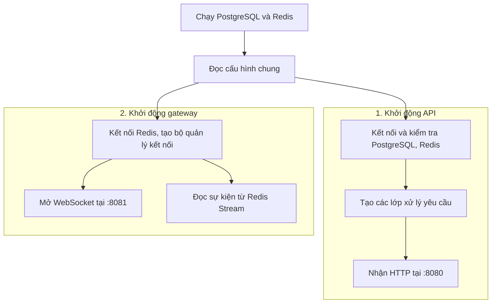

Trong API, yêu cầu đi qua **handler → service → repository → PostgreSQL**: đọc request → kiểm tra nghiệp vụ → lưu dữ liệu. Request gửi kèm JWT, token xác nhận tài khoản đã đăng nhập. Gateway chạy việc đọc Redis và phục vụ WebSocket song song.

Hệ thống đã sẵn sàng. Bây giờ theo dõi A gửi một tin vào nhóm có A, B và C.

## Chat nhóm realtime

A gửi **“Chào nhóm”**. Client đặt mã riêng `m1` cho tin; server cấp số thứ tự `seq=7` trong cuộc trò chuyện. `m1` là ký hiệu rút gọn của UUID, còn `seq` dùng để sắp tin.

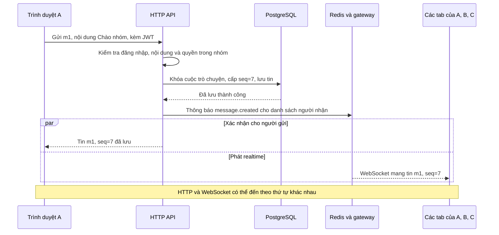

Chỉ sau khi lưu thành công, API mới phát sự kiện. Gateway đưa sự kiện vào hàng đợi của từng kết nối rồi gửi qua WebSocket; Redis ACK xác nhận gateway đã xử lý, không xác nhận người dùng đã nhận hoặc đọc.

### Trình duyệt xử lý tin nhận được

A có thể nhận `m1` qua cả HTTP và WebSocket; B/C nhận qua WebSocket. Các nguồn đều được gộp vào cùng cache (bộ nhớ tạm) của cuộc trò chuyện.

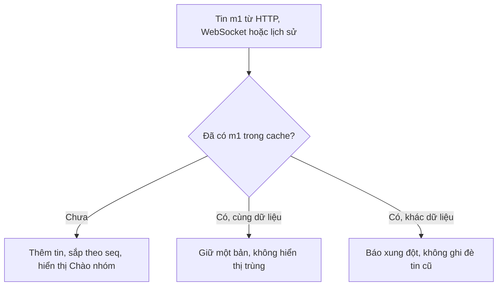

Nhóm dùng nội dung rõ. Tạo nhóm hoặc đổi thành viên cũng sinh một tin hệ thống, được lưu và phát theo luồng trên. Tiếp theo, cần giải thích API chọn danh sách người nhận như thế nào.

## Cache thành viên

Để phát `m1`, API cần biết **ai thuộc nhóm lúc tin số 7 được lưu**. Danh sách này được cache theo từng mốc thay đổi thành viên, giúp nhiều tin liên tiếp dùng lại cùng danh sách.

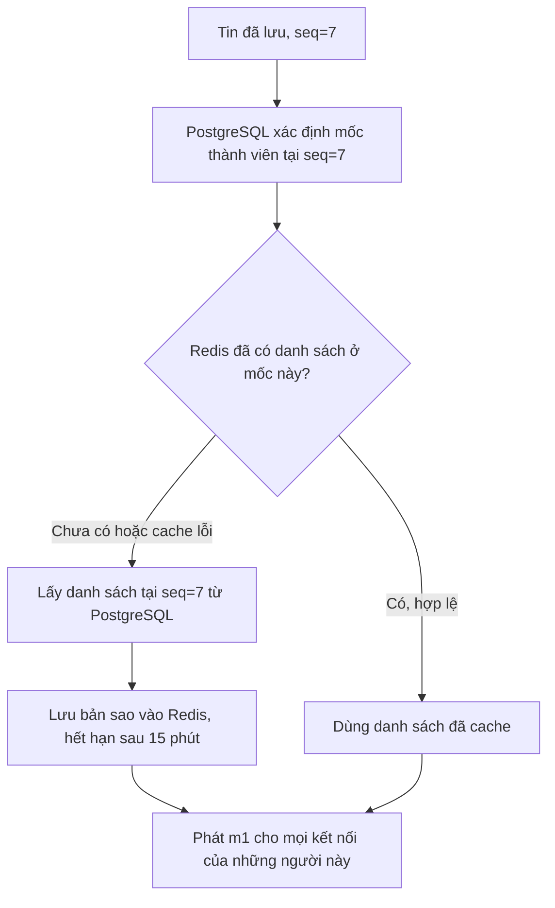

Cache chỉ giúp chọn nơi phát sự kiện; quyền gửi/đọc vẫn do PostgreSQL kiểm tra. Nếu C rời nhóm ở tin số 8, C vẫn nhận tin hệ thống số 8, nhưng bị loại khỏi người nhận từ tin số 9. Mỗi mốc có cache riêng nên không dùng danh sách hiện tại để phát lại một tin cũ.

Chọn đúng người nhận chưa đủ: mạng có thể mất response hoặc gửi lại cùng sự kiện. Mã `m1` giải quyết phần đó.

## Retry, pending và dữ liệu client

Nếu A chưa nhận được xác nhận, client giữ tin trong **pending** — bản gửi đang chờ kết quả. Gửi lại phải dùng đúng `m1` và nội dung ban đầu.

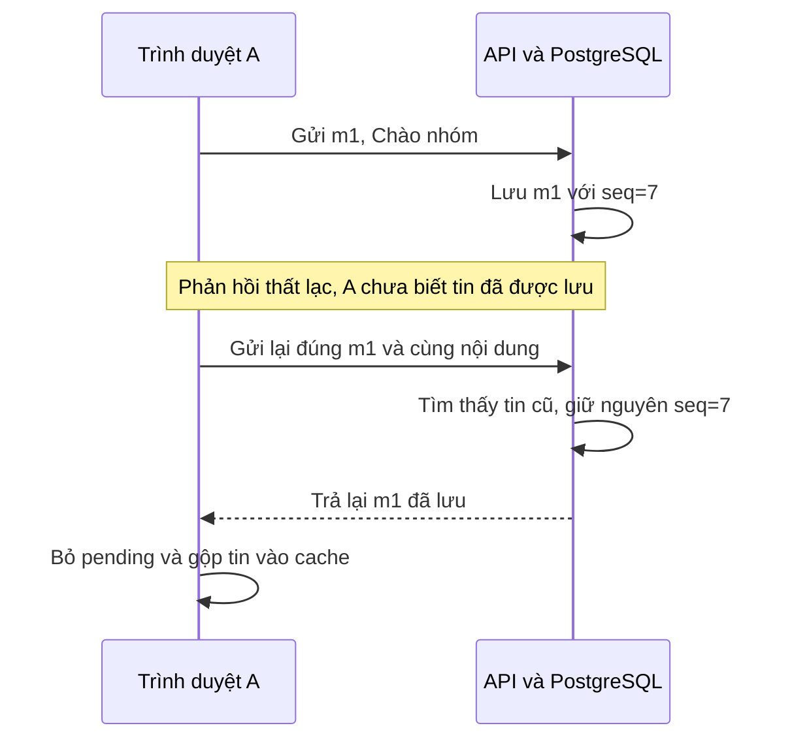

- Lỗi mạng/timeout/5xx có thể xảy ra sau commit: giữ bản gửi lại. UUID cũ với payload khác bị từ chối `409`.
- Tin nhóm bị từ chối `400/413`: bỏ pending, giữ draft để sửa và gửi tin mới. Tin nhóm được kiểm tra trước khi tạo UUID: sau trim có 1–1000 ký tự Unicode, không NUL.

Gửi lại giải quyết phía A. Còn nếu B offline và không nhận WebSocket, B cần lấy tin từ lịch sử.

## Lịch sử, cache và reconnect

PostgreSQL đã giữ `m1`, nên B có thể lấy bù khi kết nối lại. Cache phía trình duyệt giữ những tin đã tải; nó khác cache danh sách thành viên trong Redis ở phần trước.

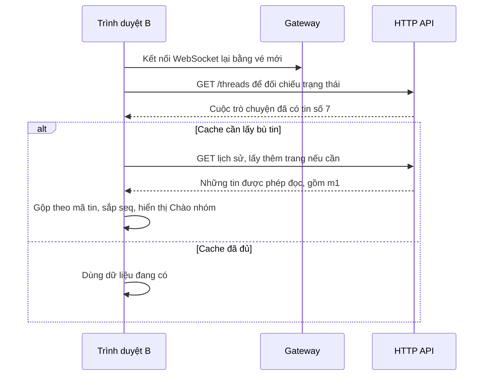

Tin thiếu cũng được lấy bù khi client phát hiện khoảng trống trong sequence. Lịch sử dùng cursor `before_seq`, trả trang từ mới đến cũ; client hiển thị từ cũ đến mới. B chỉ đọc các khoảng mình từng ở trong nhóm. Việc lấy bù theo sự kiện hoặc thao tác, không polling.

B đã lấy lại tin. Kết nối đó cũng cung cấp trạng thái online/offline hiện tại; trạng thái đọc của tin được xử lý riêng ở phần sau.

## Presence: online/offline

**Trực tuyến** nghĩa là Hub còn ít nhất một socket đã xác thực và đăng ký thành công của user, chưa bị xác định là chết. **Ngoại tuyến** nghĩa là gateway đã xác định user không còn socket nào. Đăng nhập HTTP chưa tạo presence: gateway phải kiểm tra ticket/JWT, Origin, upgrade WebSocket và đăng ký socket trước.

Presence lấy trực tiếp từ map socket trong RAM của Hub, trong phạm vi **một gateway**. Mọi socket đã xác thực được xem trạng thái của các tài khoản, phù hợp với `/users` hiện liệt kê toàn bộ tài khoản. Không thêm REST endpoint, Redis key/Stream, cột database hay cache message cho presence; không có last-seen, idle hoặc ẩn trạng thái.

### Snapshot và delta

Mỗi socket mới, kể cả tab thứ hai của cùng user, nhận snapshot chứa toàn bộ user đang online, gồm chính tài khoản vừa kết nối:

```json
{
  "type": "presence.snapshot",
  "revision": 12,
  "online_user_ids": [
    "11111111-1111-4111-8111-111111111111",
    "22222222-2222-4222-8222-222222222222"
  ]
}
```

Snapshot là frame presence đầu tiên của socket. Nó thay toàn bộ tập online của tab; sau snapshot hợp lệ, tài khoản đã biết không nằm trong tập được coi là offline. Khi user mất socket cuối cùng, các socket còn lại nhận:

```json
{
  "type": "presence.changed",
  "revision": 13,
  "user_id": "22222222-2222-4222-8222-222222222222",
  "online": false
}
```

Hub chỉ tăng `revision` và phát delta khi số socket của một user chuyển **0 → 1** hoặc **1 → 0**. Thêm/bớt socket trong khi user vẫn online không tạo delta. Socket mới biết trạng thái của chính nó qua snapshot, nên không nhận lại delta online tương ứng. Việc sửa map, tăng revision, chụp snapshot và enqueue frame presence được tuần tự hóa dưới khóa Hub; writer riêng thực hiện I/O sau đó. Nhờ vậy snapshot không ghi đè một delta mới hơn và các socket nhận delta theo đúng thứ tự. Enqueue không block; queue đầy dẫn tới đóng socket để reconnect lấy snapshot, không giữ socket với delta đã bị bỏ.

`revision` là thứ tự riêng trong vòng đời gateway, không liên quan `message.seq` hay read marker. Client kiểm tra revision là số nguyên an toàn không âm, UUID hợp lệ khác nil và boolean `online`; snapshot sai không được áp dụng một phần. Delta chỉ được áp dụng sau snapshot; revision cũ/trùng bị bỏ qua. Gap revision làm cache presence mất hiệu lực và dùng reconnect/backoff hiện có để lấy snapshot mới. Snapshot cũ trên cùng socket không được ghi đè trạng thái mới. Socket mới reset revision, nên vẫn chấp nhận snapshot có revision thấp hơn sau gateway restart.

### Nhiều tab, mất kết nối và giao diện

Nếu B mở hai tab, đóng hoặc đăng xuất một tab vẫn để B online ở phía A. Chỉ khi gateway cleanup socket cuối của B mới phát offline, đúng một lần dù cleanup được gọi lại. Chuyển tab, thu nhỏ cửa sổ hoặc không thao tác không quyết định presence.

Phía người xem hiển thị **Chưa xác định** trước snapshot hoặc khi socket mất kết nối/restart; `onopen` chưa đủ để coi dữ liệu sẵn sàng. Reconnect nhận snapshot hiện tại để sửa mọi delta bỏ lỡ. Logout/đổi tài khoản xóa cache; kiểm tra generation và session bỏ event từ socket hoặc tài khoản cũ. Tập online và revision chỉ ở RAM của tab, không ghi vào `localStorage` hay `sessionStorage`.

Nhãn “Trực tuyến”, “Ngoại tuyến”, “Chưa xác định” xuất hiện ở peer direct trong sidebar, danh sách mở chat, header direct và từng thành viên nhóm. Nhãn có text bên cạnh dấu trạng thái để không phụ thuộc riêng màu sắc. Header direct dùng vùng presence riêng; `thread-status` vẫn phục vụ E2EE/nhóm. Presence update chỉ cập nhật phần DOM liên quan, giữ draft, thread đang mở, lựa chọn thành viên, vị trí đọc và E2EE. Nó không gọi `/users`, tải thread/lịch sử, tạo message hoặc tăng unread; làm mới `/users` theo thao tác sẽ gắn nhãn từ cache hiện tại. Các request lấy bù vốn có của reconnect vẫn được giữ.

Gateway gửi **WebSocket control Ping mỗi 10 giây**, chờ **Pong tối đa 5 giây**; `CloseRead()` tiếp tục xử lý control frame. Heartbeat JSON `{"type":"heartbeat"}` vẫn gửi mỗi 5 giây, không cần JavaScript gửi application ping/pong. Mất mạng im lặng thường được phát hiện trong khoảng **15 giây** trong điều kiện bình thường, không phải giới hạn tuyệt đối dưới mọi tải và điều kiện mạng. Logic tab ẩn của frontend vẫn được giữ; không tự đánh user offline từ `visibilitychange` hoặc `navigator.onLine`.

Gateway restart xóa map và revision trong RAM. Client sẽ nhận unknown khi nhận biết kết nối mất rồi khôi phục từ snapshot trên socket mới. Shutdown ưu tiên đóng socket an toàn, không bảo đảm phát đủ delta offline trước khi process dừng. Presence hiện chưa đồng bộ được giữa nhiều gateway; triển khai nhiều instance cần một quyết định kiến trúc khác.

## Read marker, unread và nhiều tab

Khi B đọc đến tin số 7, server lưu **read marker** — số thứ tự đã đánh dấu đọc. **Unread** là số tin của người khác còn sau marker trong lần tham gia nhóm hiện tại.

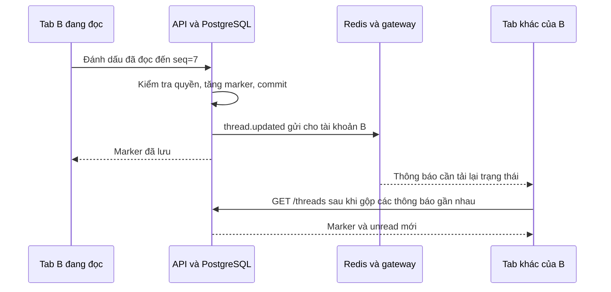

Marker chỉ tăng; client gửi khi tab đang hiển thị, ở cuối chat và tin đã được render sau sync. Publish thông báo đọc lỗi chỉ được log, marker đã commit vẫn thành công. `thread.updated` không phải tin chat và không tăng sequence.

Đến đây, nhóm đã có đủ luồng lưu, phát, gửi lại, lấy bù và đồng bộ đọc. Với chat 1-1, thêm bước bảo vệ nội dung ngay tại trình duyệt.

## E2EE: phiên cố định và khôi phục

E2EE bảo vệ **nội dung chat 1-1** từ trình duyệt gửi đến trình duyệt nhận. Trong ví dụ xuyên suốt, A gửi **“Chào B”**, có UUID rút gọn là `m2`. A mã hóa nội dung trước khi gửi; B giải mã sau khi nhận. API, PostgreSQL, Redis và gateway lưu/chuyển tiếp **bản mã**, đồng thời vẫn xử lý quyền, thứ tự tin và realtime.

Để nắm luồng, cần phân biệt **khóa dùng cho cuộc trò chuyện** và **khóa dùng để khôi phục tài khoản**:

| Khóa | Cách tạo | Phạm vi và mục đích |
| --- | --- | --- |
| **SK — khóa phiên** | X3DH: tính bí mật chung bằng X25519 rồi dẫn xuất bằng HKDF | Chung cho A/B trong một cuộc trò chuyện; làm gốc để tạo khóa từng tin |
| **MK — khóa tin** | HKDF-SHA256 từ SK và context của tin | Riêng cho một UUID và chiều gửi; trực tiếp mã hóa/giải mã tin |
| **VK — khóa mở vault** | Argon2id và HKDF từ mật khẩu, salt và username | Riêng từng tài khoản; mở bộ private keys gốc |
| **BK — khóa backup** | HKDF-SHA256 từ VK với nhãn dành cho backup | Riêng từng tài khoản; mã hóa/mở bản sao SK lưu trên server |

Các khóa trên dài **32 byte**. **Vault** chứa bộ private keys gốc đã mã hóa của tài khoản; **backup** chứa SK đã mã hóa của một cuộc trò chuyện. A/B dùng cùng SK nhưng có VK, BK và backup riêng. Server giữ public keys, dữ liệu mã hóa và metadata; client xử lý nội dung rõ và các khóa bí mật.

**Epoch** là bản ghi phiên khóa của cuộc trò chuyện. **Context** là các ID xác định tin thuộc cuộc trò chuyện, phiên và chiều gửi nào. **AAD** là cách biểu diễn context thành dữ liệu được xác thực cùng bản mã. **Nonce** là giá trị ngẫu nhiên dùng khi mã hóa. **Envelope** là gói JSON mang bản mã và thông tin để giải mã.

Hai sơ đồ đầu giải thích cách dùng khóa: A đã có SK, B lấy SK đúng epoch khi nhận. Sau đó là cách A/B có cùng SK và cách máy mới khôi phục SK.

### 1. Mã hóa khi gửi

**Đầu vào:** nội dung “Chào B”, SK của epoch đã xác nhận, UUID mới `m2` và hai tài khoản A/B. **Đầu ra:** envelope để gửi qua API.

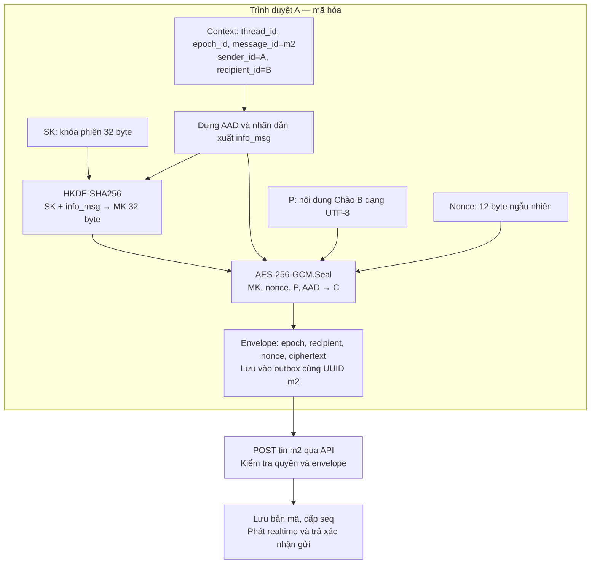

| Bước | Tham số và phương thức | Kết quả |
| --- | --- | --- |
| Tạo context/AAD | `thread_id`, `epoch_id`, `message_id`, `sender_id`, `recipient_id`; đóng gói theo thứ tự cố định | AAD gắn tin với đúng cuộc trò chuyện, epoch và chiều A → B |
| Dẫn xuất khóa tin | HKDF-SHA256: input `SK`, `salt=nil`, `info=nhãn cố định + AAD`, output 32 byte | MK của riêng tin `m2` |
| Mã hóa nội dung | AES-256-GCM `Seal(MK, nonce, P, AAD)`; nonce ngẫu nhiên 12 byte | C gồm bản mã và tag xác thực 16 byte |
| Gửi dữ liệu | Body `{message_id, content_format: "e2ee_v2", content}`; `content` là chuỗi JSON envelope | Server lưu/phát bản mã và metadata |

Envelope gồm `{version: 2, epoch_id, recipient_id, nonce, ciphertext}`; nonce và ciphertext được biểu diễn bằng **Base64**. Base64 giúp đưa byte vào JSON; AES-GCM thực hiện mã hóa. `P` được trim, kiểm tra 1–1000 ký tự Unicode và không NUL trước khi mã hóa.

`seq` được server cấp khi lưu, chỉ phục vụ thứ tự tin. Nonce dùng cho AES-GCM; UUID/context tham gia tạo MK. SK và MK được dùng tại client. Nếu cần gửi lại, client dùng đúng UUID và envelope đã giữ trong outbox.

### 2. Giải mã khi nhận

**Đầu vào:** tin `m2`, metadata và envelope từ WebSocket hoặc lịch sử. **Đầu ra:** nội dung “Chào B” sau khi xác thực thành công. B đã đăng nhập và mở vault để có thể khôi phục khóa khi cần.

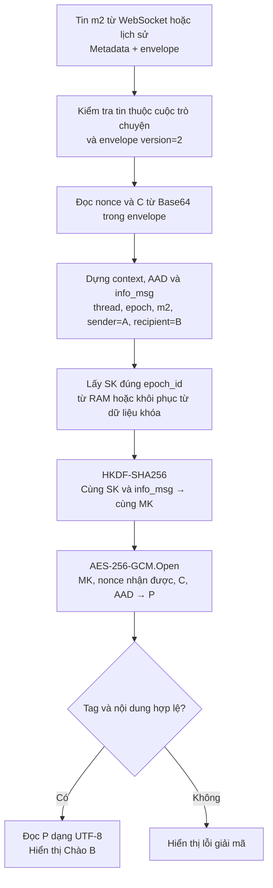

| Tham số | B lấy từ đâu? | Dùng để làm gì? |
| --- | --- | --- |
| `thread_id`, `message_id`, `sender_id` | Metadata của tin; UUID tin ở `id` hoặc `message_id` tùy nguồn | Dựng context của tin đang nhận |
| `epoch_id`, `recipient_id` | Epoch từ envelope; recipient xác định từ chiều gửi rồi kiểm tra khớp envelope | Chọn SK đúng phiên, hoàn thiện context |
| `nonce`, `C` | Giải mã Base64 của hai trường trong envelope | Đầu vào AES-GCM `Open`; dùng lại nonce A đã tạo |
| `SK`, `MK`, `AAD` | Khôi phục SK theo epoch, dựng cùng AAD và chạy cùng HKDF như A | Tạo lại khóa tin và xác thực bản mã |

A/B có cùng **SK + context**, nên dẫn xuất được cùng **MK**. `Open(MK, nonce, C, AAD)` kiểm tra tag và giải mã; client kiểm tra tiếp UTF-8, độ dài và NUL trước khi hiển thị. Tin từ WebSocket và lịch sử dùng chung bước này.

Các tab của A cũng nhận sự kiện và tự giải mã tin A đã gửi. Recipient trong context là **người nhận theo chiều gửi của tin**; `recipient_id` ngoài envelope của sự kiện WebSocket là tài khoản được phát sự kiện. Client chỉ tăng read marker khi các tin đã tải được giải mã/render thành công và thỏa điều kiện đọc đã nêu ở phần trước.

### 3. A và B có cùng khóa phiên như thế nào?

Đây là bước **thỏa thuận khóa**, diễn ra khi cuộc trò chuyện chưa có epoch. A dùng khóa riêng của mình và public bundle của B để tính SK. B dùng khóa riêng của B và **bootstrap** do A lưu để tính lại cùng SK; B có thể offline lúc A khởi tạo.

| Khóa đầu vào X3DH | Vai trò |
| --- | --- |
| `IK_A`, `IK_B` | Cặp khóa định danh gốc của A/B; private key nằm trong vault |
| `SPK_B` | Prekey có chữ ký của B; A kiểm tra chữ ký bằng `IK_B.pub` trước khi dùng |
| `OPK_B`, nếu còn | Prekey công khai được claim một lần; private key vẫn được giữ trong vault B để khôi phục |
| `EK_A` | Cặp khóa tạm thời A sinh cho lần khởi tạo; public key đi vào bootstrap, private key được xóa sau khi tạo SK |

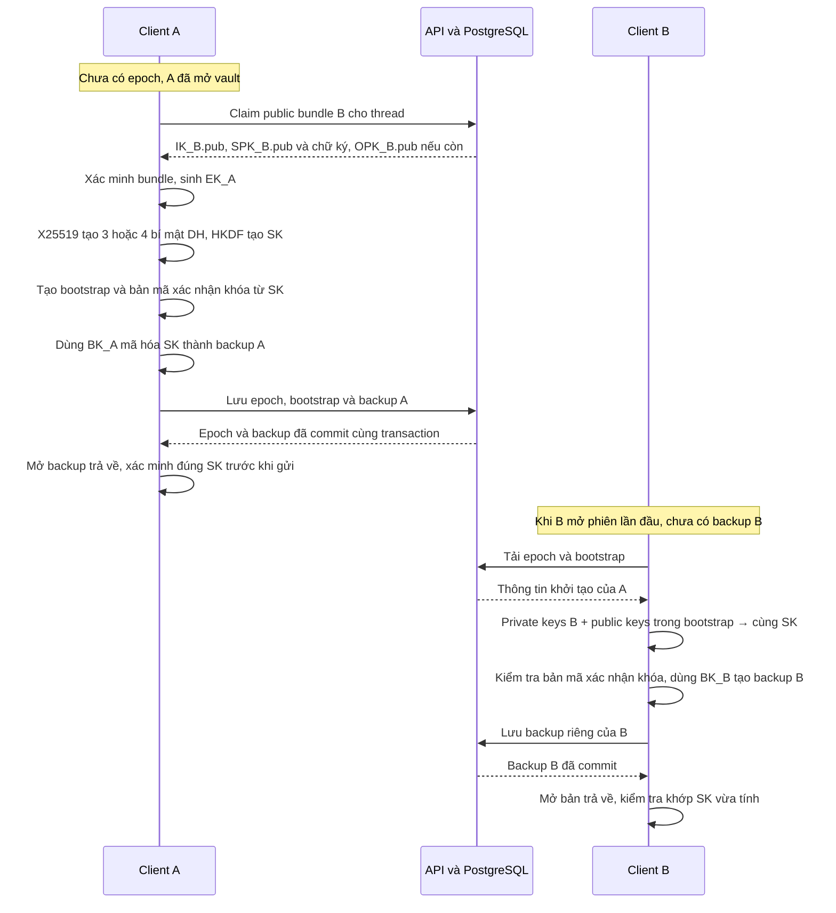

**Phương thức:** X25519 tạo các bí mật DH bằng private key của một bên và public key của bên còn lại. Hai bên tính được cùng kết quả; HKDF-SHA256 biến các kết quả đó thành SK 32 byte. Có OPK thì dùng 4 DH, hết OPK thì dùng 3 DH. Vai trò từng khóa, công thức và trình tự API được giải thích riêng ở [luồng X3DH](#x3dh-khởi-tạo-khóa-phiên-giữa-a-và-b).

**Bootstrap** chứa ID phiên, public keys, ID prekey và bản mã của một chuỗi xác nhận cố định. Client dẫn xuất khóa xác nhận từ SK, mở bản mã này rồi kiểm tra đúng chuỗi cố định, qua đó kiểm tra khóa khớp với thông tin epoch. A/B lưu **hai backup riêng cho cùng SK**; BK_A/BK_B được dẫn xuất từ VK của từng tài khoản.

Một direct dùng **một epoch cố định cho cả hai chiều và mọi thiết bị**. Khi B trả lời A, SK giữ nguyên, còn context tin đổi thành `sender_id=B`, `recipient_id=A`, nên MK khác. Đăng nhập/reload/reconnect dùng lại epoch đã có.

### 4. Đồng bộ khóa trên thiết bị khác

B đăng nhập trên máy mới và muốn đọc lại `m2`. Máy mới cần khôi phục **VK để mở vault**, rồi **BK để mở backup**, từ đó lấy lại **SK** và quay về luồng giải mã ở mục 2. Các thiết bị khôi phục độc lập từ dữ liệu tài khoản trên server.

Mật khẩu tạo một khóa gốc tạm (`Master`); HKDF tách từ Master hai giá trị: **credential** gửi cho server để xác thực đăng nhập và **VK** giữ tại client để mở vault.

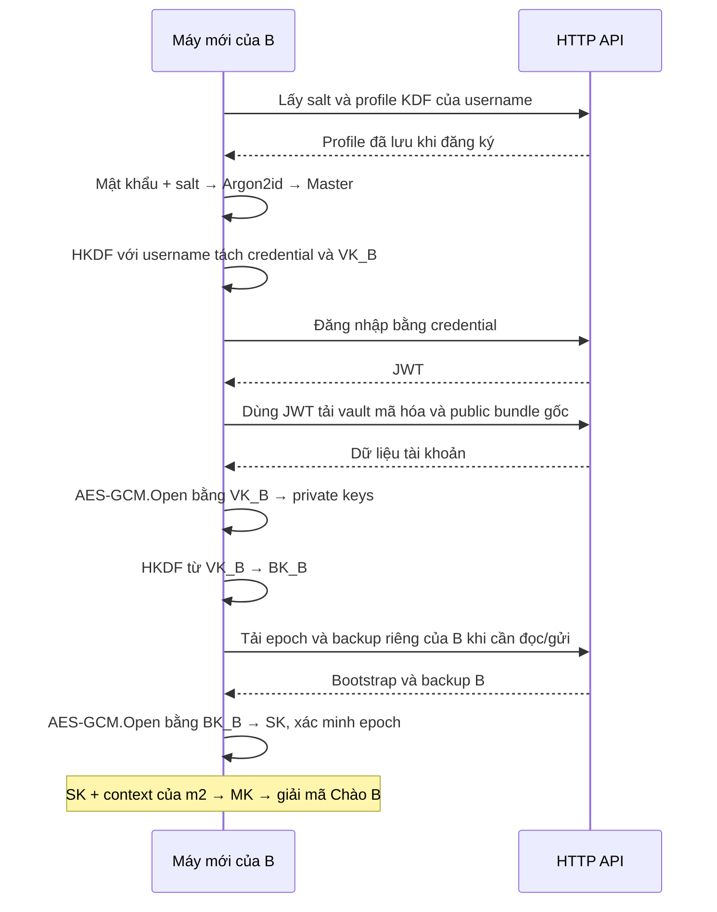

| Bước | Tham số đầu vào và phương thức | Đầu ra |
| --- | --- | --- |
| Tạo lại khóa tài khoản | Argon2id: mật khẩu UTF-8, salt 16 byte, RAM 65536 KiB, 3 lượt, parallelism 4, output 32 byte; HKDF với username đã chuẩn hóa và hai nhãn khác nhau | Credential để đăng nhập và VK để mở vault |
| Mở vault | AES-256-GCM `Open(VK, nonce_vault, ciphertext_vault, AAD_vault)`; AAD gắn username, profile KDF và public bundle gốc | Bộ private keys gốc |
| Tạo khóa backup | HKDF-SHA256: input VK, salt=nil, nhãn dành cho backup, output 32 byte | BK |
| Mở backup | AES-256-GCM `Open(BK, nonce_backup, ciphertext_backup, AAD_backup)`; AAD gắn owner, thread, epoch và hash bootstrap | SK 32 byte; kiểm tra bản mã xác nhận khóa trước khi dùng |

Server chỉ trả backup của **chính tài khoản gọi API**. Sơ đồ mô tả trường hợp B đã có backup. Nếu chưa có, B là recipient của epoch nên dùng private keys trong vault và bootstrap để tính SK như mục 3, lưu backup, rồi mở bản server trả về trước khi sử dụng. Bên khởi tạo cần backup để khôi phục vì private key tạm thời đã xóa.

Client khôi phục SK khi cần đọc/gửi từng cuộc trò chuyện; lịch sử có thể được tải trước khi khóa được mở. Private keys và SK nằm trong RAM của tab; VK còn được giữ trong `sessionStorage` để reload cùng phiên. Việc lưu dữ liệu trình duyệt được trình bày ở phần đăng nhập bên dưới.

### Quy tắc của thiết kế hiện tại

| Tình huống | Cách xử lý |
| --- | --- |
| Nhiều client cùng tạo epoch | Server khóa thread, chọn epoch đầu tiên. Đề xuất khác nhận `409` và khôi phục epoch đã chọn trước khi dùng khóa |
| Nhiều thiết bị cùng lưu backup | Server giữ bản đầu tiên cho `(epoch_id, user_id)`; client mở bản server trả về, xác minh và đối chiếu SK vừa tính |
| Mất xác nhận gửi | Giữ UUID và envelope trong outbox để retry, gộp tin theo UUID |
| Giải mã thất bại | Hiển thị lỗi; chờ giải mã/render thành công trước khi tăng read marker |

Dự án dùng phiên cố định, chưa có rekey hay Double Ratchet. Giữ vault và backup giúp khôi phục lịch sử, đồng thời làm tăng phạm vi lịch sử có thể bị lộ khi khóa tài khoản bị lộ. Quên mật khẩu và mất mọi khóa đã mở thì không thể khôi phục; đánh đổi được nêu trong [ADR 005](adr/005-recoverable-e2ee-sessions.md).

<details>
<summary>Tra cứu kỹ thuật: công thức chính xác, định dạng dữ liệu và code</summary>

**Ký hiệu:** `HKDF(input, salt, info, length)` dùng SHA-256; salt=nil là không truyền salt riêng, length tính bằng byte. `+` nối byte; `\0` là một byte NUL; `UUID(x)` là UUID 16 byte. `Seal/Open` bên dưới là ký hiệu cho AES-256-GCM với key, nonce, nội dung và AAD. Mỗi lần Seal sinh nonce ngẫu nhiên 12 byte; ciphertext kèm tag 16 byte.

**Tin nhắn — [`SealMessage/OpenMessage`](../internal/e2ee/messages.go):**

```text
AAD_msg = "Mini-Hermes/message/v2\0"
          + UUID(thread_id) + UUID(epoch_id) + UUID(message_id)
          + UUID(sender_id) + UUID(recipient_id)
info_msg = "Mini-Hermes/message-key/v2\0" + AAD_msg
MK = HKDF(SK, nil, info_msg, 32)
C  = Seal(MK, nonce, P, AAD_msg)
P  = Open(MK, nonce, C, AAD_msg)
```

**Xác nhận epoch — [`CreateEpoch/OpenEpoch`](../internal/e2ee/epoch.go):** SK được tạo theo [công thức X3DH](#bước-3-hai-bên-tính-cùng-sk) bên dưới; context phiên được gắn vào bản mã xác nhận.

```text
AAD_epoch = "Mini-Hermes/key-epoch/v2\0"
            + UUID(thread_id) + UUID(epoch_id) + UUID(sender_id) + UUID(recipient_id)
            + Pub(IK_A) + Pub(IK_B) + Pub(EK_A)
            + uint64BE(signed_prekey_id) + uint64BE(one_time_prekey_id hoặc 0)
K_confirm = HKDF(SK, nil, "Mini-Hermes/epoch-confirmation-key/v2\0" + AAD_epoch, 32)
C_epoch   = Seal(K_confirm, nonce_epoch, "Mini-Hermes/epoch-confirmed/v2", AAD_epoch)
```

`Pub(K) = 0x05 + public key 32 byte`; `uint64BE` là số nguyên 8 byte big-endian. Context phiên được gắn vào AAD xác nhận; SK được dẫn xuất từ các bí mật DH. Client mở C_epoch và so với chuỗi xác nhận cố định để kiểm tra khóa.

Trường `bootstrap` qua HTTP là **chuỗi JSON** có `version=2`, `thread_id`, `epoch_id`, `sender_id`, `recipient_id`, `sender_identity_key`, `recipient_identity_key`, `ephemeral_key`, `signed_prekey_id`, `one_time_prekey_id`, `nonce`, `ciphertext`. Public keys/nonce/ciphertext là Base64. SPK có ID 1 và chữ ký 64 byte; OPK có ID 2–21 hoặc null khi hết. Sender/recipient trong bootstrap giữ vai trò khởi tạo/nhận epoch.

**Tài khoản và backup — [`DeriveCredentials/OpenAccountVault`](../internal/e2ee/account.go), [`EncryptEpochBackup/OpenEpochBackup`](../internal/e2ee/epoch.go):** username được trim và chuyển chữ thường.

```text
Master     = Argon2id(password, account_salt, iterations=3, memory=65536 KiB,
                     parallelism=4, length=32)
credential = Base64(HKDF(Master, nil, "Mini-Hermes/auth-credential/v2\0" + username, 32))
VK         = HKDF(Master, nil, "Mini-Hermes/account-vault-key/v2\0" + username, 32)
BK         = HKDF(VK, nil, "Mini-Hermes/epoch-backup-key/v2", 32)
AAD_vault  = "Mini-Hermes/account-vault/v2\0" + JSON({username, kdf, public_bundle})
header_digest = SHA256(EncodeEpochHeader(header))
AAD_backup = "Mini-Hermes/epoch-backup/v2\0"
             + UUID(owner_id) + UUID(thread_id) + UUID(epoch_id) + header_digest
C_backup   = Seal(BK, nonce_backup, SK, AAD_backup)
SK         = Open(BK, nonce_backup, C_backup, AAD_backup)
```

`public_bundle` gốc có OPK sắp theo key_id; `kdf` là toàn bộ profile đã lưu. Hash header là SHA-256 32 byte của JSON do `EncodeEpochHeader` tạo, gồm cả nonce/ciphertext xác nhận. Owner là một trong hai tài khoản của epoch.

Vault/backup dùng record `{version: 1, nonce, ciphertext}` với nonce/ciphertext Base64; backup có plaintext SK 32 byte và ciphertext 48 byte gồm tag. Client kiểm tra confirmation của epoch sau khi mở backup. [Client E2EE](../web/e2ee.js) điều phối request, cache và khôi phục; [outbox](../web/e2ee-state.js) giữ bản gửi chưa xác nhận.

</details>

## X3DH: khởi tạo khóa phiên giữa A và B

**X3DH (Extended Triple Diffie-Hellman)** là bước thỏa thuận để A và B tự tính ra cùng **SK 32 byte**, kể cả khi B đang offline. Trong dự án, bước này chạy khi client cần gửi vào một direct chưa có epoch. SK sau đó làm gốc dẫn xuất khóa từng tin như phần E2EE ở trên.

**Đầu vào:** private key định danh của A, public bundle của B và các ID của cuộc trò chuyện/epoch. **Đầu ra:** SK tại client A, bootstrap công khai kèm bản mã xác nhận và backup SK đã mã hóa. B dùng bootstrap cùng private keys của mình để tính lại SK; SK không được gửi dưới dạng rõ lên server.

### Bước 1. B chuẩn bị khóa trước khi có cuộc trò chuyện

Khi đăng ký, client tạo bộ khóa và mã hóa private keys trong vault. Server giữ public bundle cùng hàng đợi public OPK để một người khác có thể bắt đầu chat khi B chưa online.

| Ký hiệu | Ai giữ private key? | Vai trò trong lần A khởi tạo |
| --- | --- | --- |
| `IK_A` — identity key của A | Vault A | Gắn phép tính DH với khóa định danh bên khởi tạo |
| `IK_B` — identity key của B | Vault B | Gắn phép tính DH với khóa định danh bên nhận |
| `SPK_B` — signed prekey của B | Vault B | Public key được B ký bằng `IK_B.priv`; A kiểm tra chữ ký trước khi dùng |
| `OPK_B` — one-time prekey của B | Vault B | Thêm một phép DH nếu server còn public OPK chưa claim |
| `EK_A` — ephemeral key của A | Tạo tạm tại client A | Cặp khóa mới cho lần khởi tạo; xóa private key sau khi tạo SK |

`.priv` và `.pub` bên dưới lần lượt là khóa riêng và khóa công khai X25519, mỗi khóa dài 32 byte. Dự án tạo sẵn **20 OPK** cho mỗi tài khoản, SPK có ID 1 và OPK có ID 2–21. EK được sinh ngẫu nhiên khi khởi tạo phiên; mật khẩu dùng để mở vault chứa các khóa gốc đã tạo trước đó.

### Bước 2. A lấy bundle và đề xuất phiên khóa

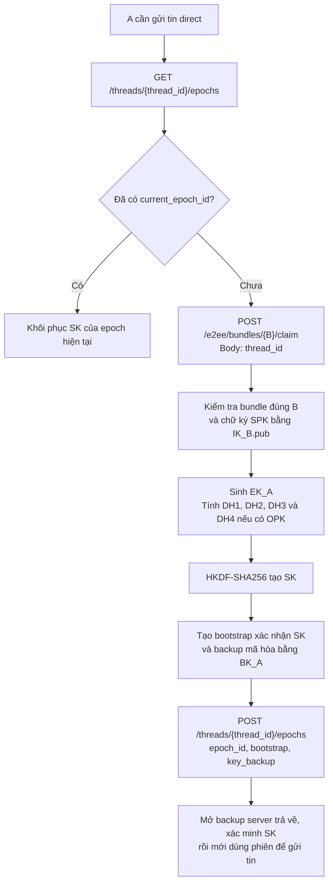

API claim kiểm tra A/B là hai thành viên của direct, khóa bản ghi user B và lấy một public OPK trong transaction. OPK được **xóa khỏi hàng đợi ngay khi claim**, nên các lần claim thành công không nhận lại cùng OPK. Nếu hết OPK, bundle vẫn có IK/SPK và A dùng nhánh 3 DH. Chữ ký SPK không hợp lệ thì client dừng khởi tạo.

### Bước 3. Hai bên tính cùng SK

Với X25519, `DH(private_A, public_B)` và `DH(private_B, public_A)` cho cùng bí mật. Hai bên tính từng hàng sau theo cùng thứ tự, rồi nối kết quả để đưa vào HKDF:

| Bí mật | A tính khi tạo phiên | B tính khi mở phiên |
| --- | --- | --- |
| DH1 | `X25519(IK_A.priv, SPK_B.pub)` | `X25519(SPK_B.priv, IK_A.pub)` |
| DH2 | `X25519(EK_A.priv, IK_B.pub)` | `X25519(IK_B.priv, EK_A.pub)` |
| DH3 | `X25519(EK_A.priv, SPK_B.pub)` | `X25519(SPK_B.priv, EK_A.pub)` |
| DH4, nếu có OPK | `X25519(EK_A.priv, OPK_B.pub)` | `X25519(OPK_B.priv, EK_A.pub)` |

DH1 và DH2 đưa khóa định danh của hai bên vào thỏa thuận. DH3 đưa khóa tạm thời của A và prekey của B vào phép tính; DH4 bổ sung prekey chỉ được cấp một lần. Tên Triple DH chỉ ba phép cơ sở; khi có OPK, X3DH thực hiện thêm phép thứ tư.

Trong [`deriveKey`](../internal/e2ee/crypto.go#L163), mỗi kết quả DH dài 32 byte; công thức thực tế là:

```text
IKM = (32 byte 0xff) + DH1 + DH2 + DH3 [+ DH4 nếu có OPK]
SK  = HKDF-SHA256(
        input = IKM,
        salt = 32 byte 0x00,
        info = "Mini-Hermes/X3DH/v1",
        length = 32 byte
      )
```

`+` là nối byte. Hai bên dùng cùng bộ khóa tương ứng, cùng thứ tự DH và tham số HKDF nên có cùng SK. Server chỉ có public keys và dữ liệu mã hóa, không có private keys cần để tính các bí mật DH này.

### Bước 4. B mở bootstrap và xác nhận khóa

Bootstrap A lưu chứa `IK_A.pub`, `IK_B.pub`, `EK_A.pub`, ID SPK/OPK, các ID thread/epoch/A/B và bản mã xác nhận. Private key tạm thời của A được xóa sau khi tạo SK; public key tạm thời vẫn nằm trong bootstrap để B tính DH2–DH4.

Khi B online và cần mở phiên lần đầu:

1. B tải `GET /threads/{thread_id}/epochs`. Nếu đã có backup riêng, B mở backup để khôi phục SK.
2. Nếu chưa có backup, B kiểm tra bootstrap thuộc đúng thread và hai tài khoản, rồi chọn private IK/SPK/OPK trong vault theo các ID của bootstrap.
3. B chạy [`OpenEpoch`](../internal/e2ee/epoch.go#L190), tính các DH ở cột B và dẫn xuất cùng SK. Từ SK và context epoch, client tạo khóa xác nhận rồi mở bản mã bằng AES-GCM; nội dung phải khớp `Mini-Hermes/epoch-confirmed/v2`. Sai khóa hoặc dữ liệu xác nhận bị sửa thì không dùng phiên.
4. B dùng BK_B mã hóa SK và gửi `PUT /threads/{thread_id}/epochs/{epoch_id}/key`. Client mở backup server trả về và kiểm tra bằng SK vừa tính trước khi cache khóa.
5. A/B đã có cùng SK. Tin “Chào B” được mã hóa/giải mã bằng MK dẫn xuất từ SK và context của từng tin; B trả lời cũng dùng epoch này.

API lưu bootstrap, backup A và `current_epoch_id` trong cùng transaction. Vì A không còn `EK_A.priv`, backup đã lưu là dữ liệu cần để A khôi phục SK trên máy mới.

### Các trường hợp cần hiểu đúng trong dự án

| Trường hợp | Hành vi hiện tại |
| --- | --- |
| B offline khi A bắt đầu | A dùng public prekeys đã đăng ký; B tính SK sau từ bootstrap và vault |
| Hết public OPK | Direct mới dùng DH1–DH3; các epoch đã có giữ nguyên SK |
| A/B cùng khởi tạo | Server khóa thread, giữ epoch commit đầu tiên; đề xuất còn lại nhận `409`, bỏ SK đề xuất và khôi phục epoch server đã chọn |
| Reload, đăng nhập lại hoặc đổi máy | Dùng epoch đã có và backup riêng; recipient chưa có backup có thể tính lại từ vault/bootstrap |
| Public OPK đã claim | Public OPK bị xóa khỏi hàng đợi; private OPK vẫn nằm trong vault để khôi phục phiên |

Việc giữ private prekeys và backup SK là đánh đổi phục hồi lịch sử của [ADR 005](adr/005-recoverable-e2ee-sessions.md). Dự án dùng một epoch cố định, chưa có Double Ratchet hay rekey, nên không có cơ chế tự phục hồi bảo mật sau khi khóa bị lộ. Kiểm tra chữ ký SPK xác nhận SPK khớp với IK được cung cấp; UI hiện chưa có bước đối chiếu fingerprint ngoài kênh để xác minh IK đó thuộc đúng người.

Đọc code theo thứ tự: [`GenerateAccountVault`](../internal/e2ee/account.go#L101) → [`Claim`](../internal/module/e2ee/repository/postgres.go#L40) và [SQL tiêu thụ OPK](../db/queries/prekeys.sql) → [`CreateEpoch`](../internal/e2ee/epoch.go#L121) / [`deriveKey`](../internal/e2ee/crypto.go#L163) → [`OpenEpoch`](../internal/e2ee/epoch.go#L190) → [client điều phối phiên và backup](../web/e2ee.js#L138). Test đối chiếu: [`TestEpoch3DH4DHAndStatelessReplies`](../internal/e2ee/session_test.go#L119).

Nguồn giải thích giao thức: [đặc tả X3DH của Signal](https://signal.org/docs/specifications/x3dh/). Luồng trên mô tả profile Mini-Hermes; các quyết định giữ khóa và backup tuân theo ADR 005 của dự án.

Các luồng trên cần bộ khóa gốc và vault có thể mở lại bằng mật khẩu. Phần đăng ký tiếp theo giải thích cách tài khoản tạo và lưu những dữ liệu đó.

## Đăng ký

**Vault** là bộ khóa riêng dùng cho X3DH của tài khoản, được mã hóa trước khi lưu server. Backup SK của từng cuộc trò chuyện được lưu riêng, bảo vệ bằng khóa dẫn xuất từ khóa mở vault.

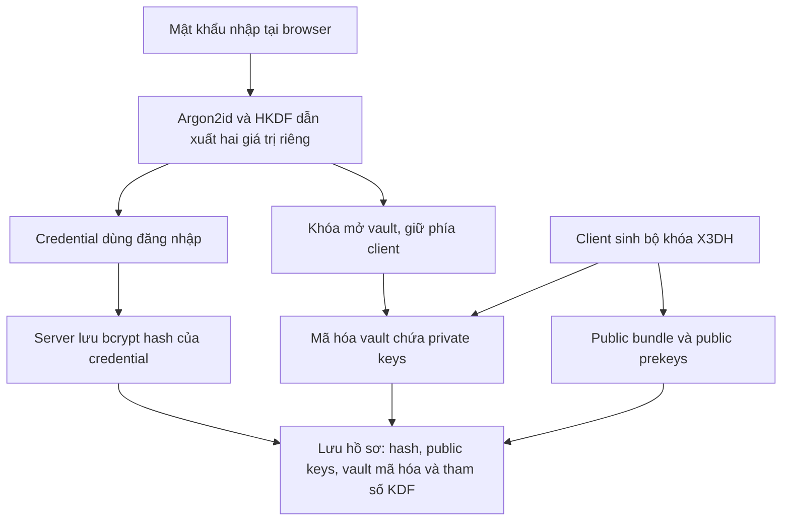

**Credential** là giá trị dẫn xuất để server kiểm tra đăng nhập, không phải mật khẩu gốc. Public keys phục vụ khởi tạo phiên; vault giữ các private keys để phục hồi, kể cả khi public prekey đã được claim. Server lưu thêm salt và tham số KDF để máy mới tạo lại đúng credential/khóa mở vault. Sau đăng ký thành công, web tự đăng nhập bằng credential vừa tạo.

Server đã có hồ sơ tài khoản và dữ liệu khóa mã hóa. Đăng nhập vừa xác thực user, vừa mở lại khóa ở client để thực hiện các bước chat phía trên.

## Đăng nhập và vé WebSocket

KDF là cách tạo khóa từ mật khẩu và **salt**, giá trị ngẫu nhiên của tài khoản được lưu từ lúc đăng ký. Máy mới dùng lại đúng salt và tham số đó.

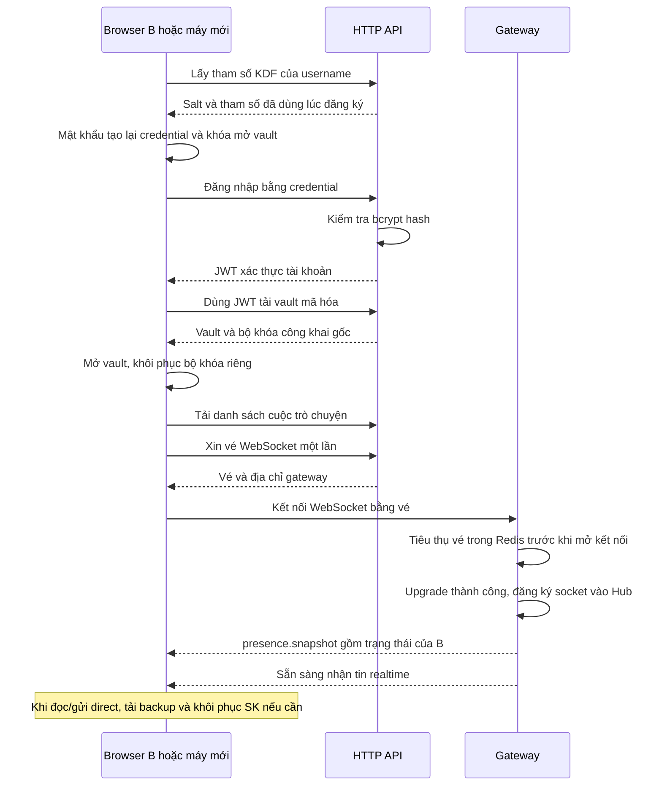

JWT xác thực các request HTTP. Vé WebSocket dùng một lần, mặc định hết hạn sau 30 giây; browser xin vé mới mỗi lần kết nối lại. Các bước đã đủ để B tham gia luồng gửi/nhận và khôi phục lịch sử bằng cùng tài khoản trên nhiều thiết bị.

| Dữ liệu phía client | Nơi lưu |
| --- | --- |
| Private keys đã mở, SK, plaintext, cache tin và presence | RAM của tab |
| JWT, username, user UUID, khóa mở vault để reload cùng phiên | `sessionStorage`, xóa khi đăng xuất |
| UUID/context/envelope/body của tin direct chưa xác nhận | Outbox trong `localStorage`, fallback RAM nếu storage lỗi |

Quên mật khẩu và mất mọi khóa đã mở thì không phục hồi được. Vault và backup phải còn trên server; giữ archive khóa để đọc lịch sử là đánh đổi được nêu trong [ADR 005](adr/005-recoverable-e2ee-sessions.md).

<details>
<summary>Đối chiếu code và giới hạn triển khai</summary>

| Luồng | Điểm đọc code |
| --- | --- |
| Khởi động API / gateway | [`run`](../cmd/main.go), [`run/serve`](../cmd/ws-gateway/main.go) |
| Handler → service → repository | [router](../internal/route/router.go), [`Send`](../internal/module/message/service/service.go), [transaction gửi tin](../internal/module/message/repository/postgres.go) |
| Publish, queue, ACK | [`PublishMessage`](../internal/module/message/service/publish.go), [`handleStreams`](../internal/gateway/consumer.go), [`Dispatch/writeLoop`](../internal/gateway/hub.go) |
| Presence và vòng đời socket | [payload presence](../internal/gateway/presence.go), [`add/remove/writeLoop`](../internal/gateway/hub.go), [client presence](../web/app.js) |
| Nhóm và membership | [`CreateGroup/ChangeMember`](../internal/module/thread/repository/groups.go), [queries](../db/queries/groups.sql) |
| Cache thành viên | [`messageRecipients`](../internal/module/message/service/publish.go), [queries tại sequence](../db/queries/messages.sql), [`Redis.Get/Put`](../internal/module/thread/membership/redis.go) |
| Gộp tin, catch-up và read marker | [realtime core](../web/realtime-core.js), [`loadThreads/flushReadMarker`](../web/app.js), [`MarkRead`](../internal/module/thread/service/service.go) |
| Khóa phiên, tin mã hóa và backup | [client E2EE](../web/e2ee.js), [X3DH và backup](../internal/e2ee/epoch.go), [mã hóa tin](../internal/e2ee/messages.go) |
| Đăng ký, đăng nhập và vault | [`DeriveCredentials/EncryptAccountVault`](../internal/e2ee/account.go), [`Register/Login`](../internal/module/user/service/service.go), [lưu tài khoản](../internal/module/user/repository/postgres.go) |
| Dữ liệu client và danh sách user | [outbox](../web/e2ee-state.js), [`cacheSession/clearSession/loadUsers`](../web/app.js) |

- Cache thành viên dùng mốc lớn nhất không vượt seq: `joined_seq` hoặc `left_seq+1`. Redis GET/SET tối đa 100 ms trong tổng publish timeout; lỗi ghi cache chỉ log.
- Publish message lỗi sau commit trả `503`; retry giữ UUID/body. Chưa có transactional outbox backend. Gateway hiện hỗ trợ một instance; queue đầy/kết nối chậm bị đóng để client lấy bù REST. Xem [ADR 001](adr/001-gateway-and-stream.md), [ADR 003](adr/003-message-order.md).
- Nhóm tối đa 100 người, creator là admin. Thêm/xóa/rời sinh tin hệ thống; admin cuối rời thì chuyển cho người còn lại tham gia sớm nhất. Tạo nhóm chưa có idempotency key; lỗi sau commit phải đối chiếu trước khi tạo lại.
- Marker chỉ tăng trong phạm vi membership, unread do server đếm; không bằng hiệu hai sequence. Xem [ADR 002](adr/002-unread-count.md).
- KDF v1: Argon2id, salt 16 byte, 65536 KiB, 3 lượt, parallelism 4, output 32 byte. IK/SPK/OPK là khóa định danh/prekey có chữ ký/prekey dùng một lần. Mỗi tài khoản tạo 20 OPK; direct mới hết public OPK dùng X3DH 3 DH thay vì 4 DH. AES-GCM dùng nonce 12 byte, tag 16 byte.
- UI chưa có đối chiếu fingerprint hoặc đổi mật khẩu. Nút làm mới user chỉ gọi `GET /users` theo thao tác, giữ lựa chọn còn hợp lệ và trạng thái chat. Schema/quyền membership chi tiết: [ERD](chat-api-erd.md). Cách chạy/kiểm tra: [README](../README.md).

</details>
