# Giải thích luồng Mini-Hermes

Theo dõi một tin nhắn từ lúc gửi đến khi hiển thị, rồi thêm mã hóa vào cùng luồng đó. Giả sử A, B và C đã đăng nhập; phần cuối giải thích cách đăng ký và đăng nhập chuẩn bị tài khoản, khóa và kết nối.

## Mục lục

1. [Khởi động hệ thống](#khởi-động-hệ-thống)
2. [Gửi và nhận một tin nhắn nhóm](#chat-nhóm-realtime)
3. [Chọn người nhận bằng cache thành viên](#cache-thành-viên)
4. [Gửi lại mà không tạo tin trùng](#retry-pending-và-dữ-liệu-client)
5. [Lấy bù tin khi mất kết nối](#lịch-sử-cache-và-reconnect)
6. [Đồng bộ trạng thái đọc giữa các tab](#read-marker-unread-và-nhiều-tab)
7. [Thêm E2EE vào chat 1-1](#e2ee-phiên-cố-định-và-khôi-phục)
8. [Đăng ký để tạo và bảo vệ khóa](#đăng-ký)
9. [Đăng nhập để mở lại khóa và bắt đầu chat](#đăng-nhập-và-vé-websocket)

## Khởi động hệ thống

API nhận yêu cầu và lưu tin. Gateway giữ kết nối WebSocket để đẩy tin đến các trình duyệt. Hai tiến trình dùng chung Redis Stream (hàng đợi sự kiện), còn PostgreSQL giữ lịch sử.

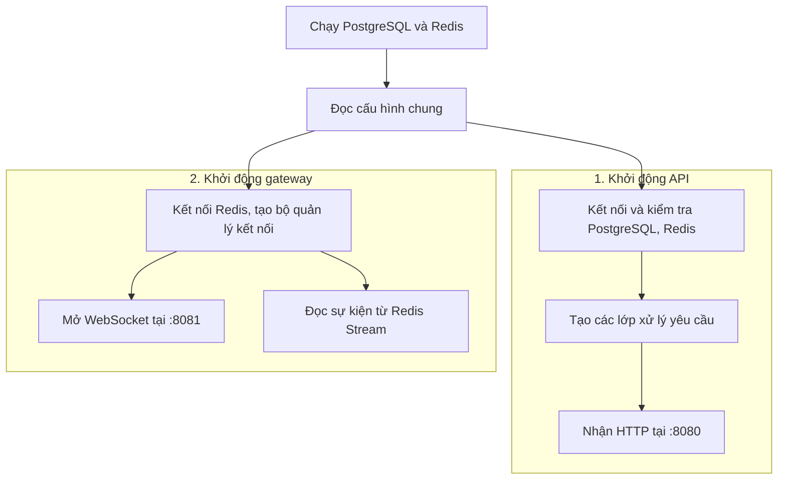

Trong API, yêu cầu đi qua **handler → service → repository → PostgreSQL**: đọc request → kiểm tra nghiệp vụ → lưu dữ liệu. Request gửi kèm JWT, token xác nhận tài khoản đã đăng nhập. Gateway chạy việc đọc Redis và phục vụ WebSocket song song.

Hệ thống đã sẵn sàng. Bây giờ theo dõi A gửi một tin vào nhóm có A, B và C.

## Chat nhóm realtime

A gửi **“Chào nhóm”**. Client đặt mã riêng `m1` cho tin; server cấp số thứ tự `seq=7` trong cuộc trò chuyện. `m1` là ký hiệu rút gọn của UUID, còn `seq` dùng để sắp tin.

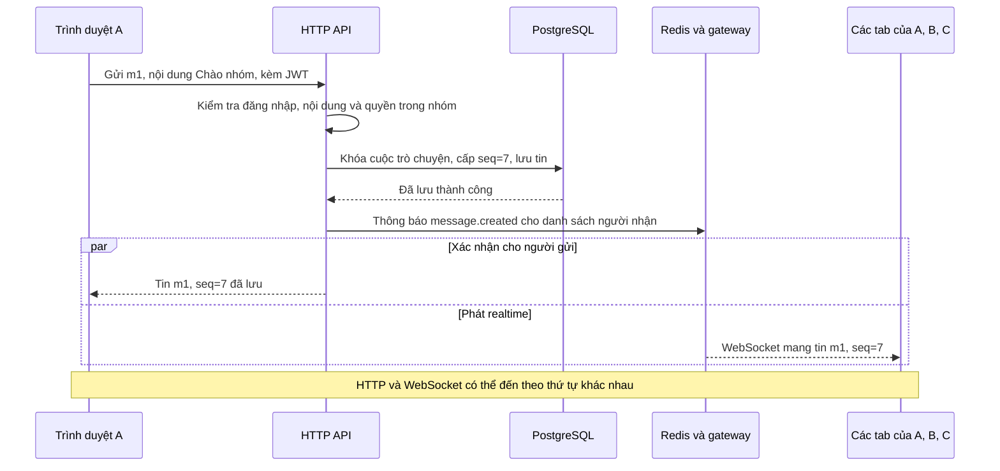

Chỉ sau khi lưu thành công, API mới phát sự kiện. Gateway đưa sự kiện vào hàng đợi của từng kết nối rồi gửi qua WebSocket; Redis ACK xác nhận gateway đã xử lý, không xác nhận người dùng đã nhận hoặc đọc.

### Trình duyệt xử lý tin nhận được

A có thể nhận `m1` qua cả HTTP và WebSocket; B/C nhận qua WebSocket. Các nguồn đều được gộp vào cùng cache (bộ nhớ tạm) của cuộc trò chuyện.

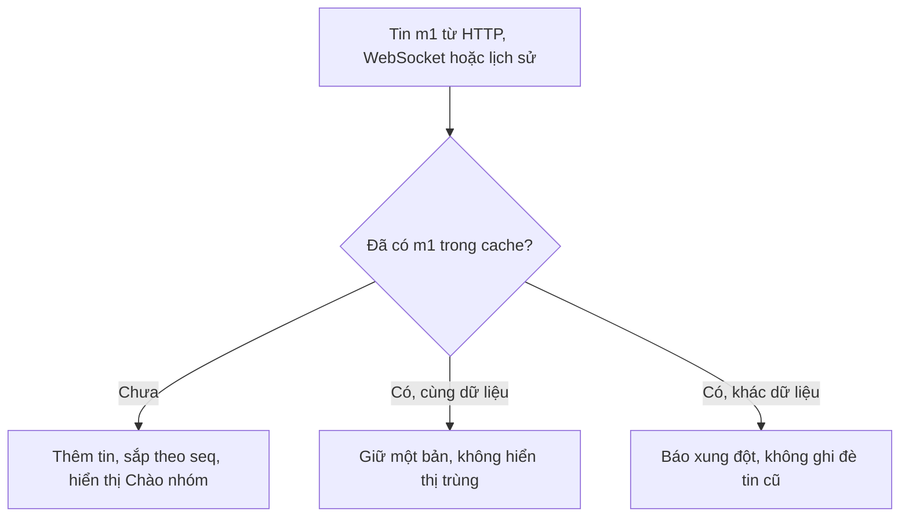

Nhóm dùng nội dung rõ. Tạo nhóm hoặc đổi thành viên cũng sinh một tin hệ thống, được lưu và phát theo luồng trên. Tiếp theo, cần giải thích API chọn danh sách người nhận như thế nào.

## Cache thành viên

Để phát `m1`, API cần biết **ai thuộc nhóm lúc tin số 7 được lưu**. Danh sách này được cache theo từng mốc thay đổi thành viên, giúp nhiều tin liên tiếp dùng lại cùng danh sách.

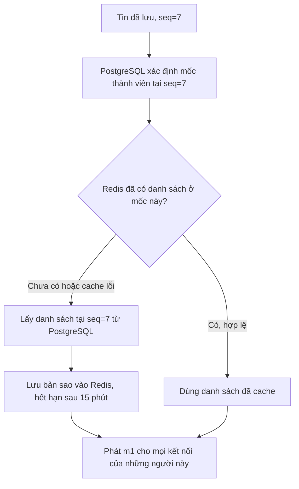

Cache chỉ giúp chọn nơi phát sự kiện; quyền gửi/đọc vẫn do PostgreSQL kiểm tra. Nếu C rời nhóm ở tin số 8, C vẫn nhận tin hệ thống số 8, nhưng bị loại khỏi người nhận từ tin số 9. Mỗi mốc có cache riêng nên không dùng danh sách hiện tại để phát lại một tin cũ.

Chọn đúng người nhận chưa đủ: mạng có thể mất response hoặc gửi lại cùng sự kiện. Mã `m1` giải quyết phần đó.

## Retry, pending và dữ liệu client

Nếu A chưa nhận được xác nhận, client giữ tin trong **pending** — bản gửi đang chờ kết quả. Gửi lại phải dùng đúng `m1` và nội dung ban đầu.

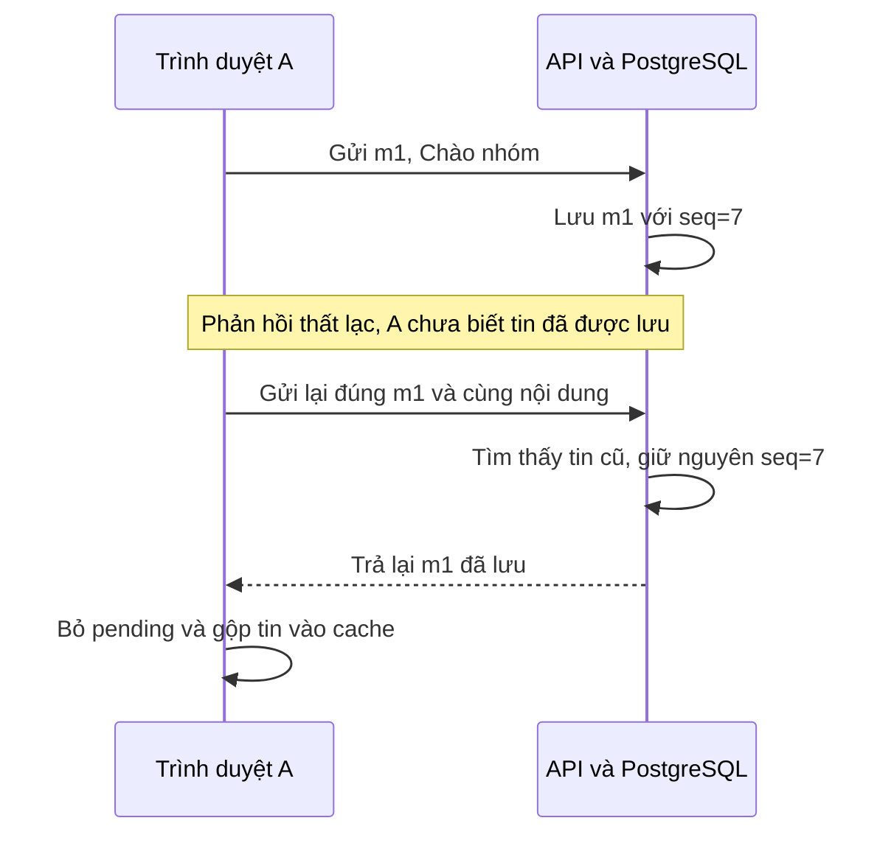

- Lỗi mạng/timeout/5xx có thể xảy ra sau commit: giữ bản gửi lại. UUID cũ với payload khác bị từ chối `409`.
- Tin nhóm bị từ chối `400/413`: bỏ pending, giữ draft để sửa và gửi tin mới. Tin nhóm được kiểm tra trước khi tạo UUID: sau trim có 1–1000 ký tự Unicode, không NUL.

Gửi lại giải quyết phía A. Còn nếu B offline và không nhận WebSocket, B cần lấy tin từ lịch sử.

## Lịch sử, cache và reconnect

PostgreSQL đã giữ `m1`, nên B có thể lấy bù khi kết nối lại. Cache phía trình duyệt giữ những tin đã tải; nó khác cache danh sách thành viên trong Redis ở phần trước.

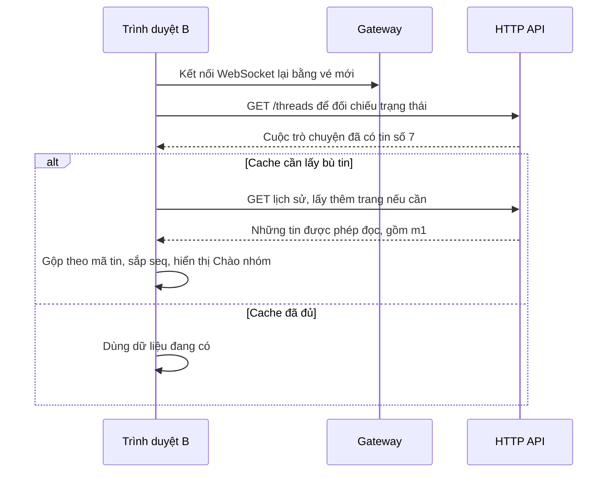

Tin thiếu cũng được lấy bù khi client phát hiện khoảng trống trong sequence. Lịch sử dùng cursor `before_seq`, trả trang từ mới đến cũ; client hiển thị từ cũ đến mới. B chỉ đọc các khoảng mình từng ở trong nhóm. Việc lấy bù theo sự kiện hoặc thao tác, không polling.

B đã thấy tin. Bước tiếp theo là cập nhật trạng thái đọc ở các tab khác của B.

## Read marker, unread và nhiều tab

Khi B đọc đến tin số 7, server lưu **read marker** — số thứ tự đã đánh dấu đọc. **Unread** là số tin của người khác còn sau marker trong lần tham gia nhóm hiện tại.

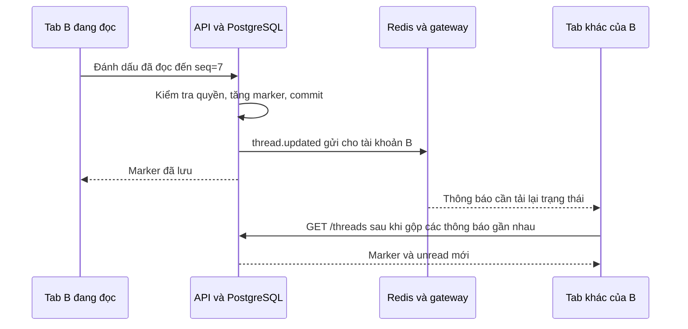

Marker chỉ tăng; client gửi khi tab đang hiển thị, ở cuối chat và tin đã được render sau sync. Publish thông báo đọc lỗi chỉ được log, marker đã commit vẫn thành công. `thread.updated` không phải tin chat và không tăng sequence.

Đến đây, nhóm đã có đủ luồng lưu, phát, gửi lại, lấy bù và đồng bộ đọc. Với chat 1-1, thêm bước bảo vệ nội dung ngay tại trình duyệt.

## E2EE: phiên cố định và khôi phục

E2EE là mã hóa đầu cuối: A mã hóa trước khi gửi, B giải mã sau khi nhận. Hai bên cần một **khóa phiên chung, gọi là SK**; mỗi tin dẫn xuất một khóa riêng từ SK. Server vẫn xử lý quyền, thứ tự và realtime, nhưng chỉ giữ bản mã và không có SK để giải mã nội dung.

### Tạo khóa phiên một lần cho A và B

Client dùng **X3DH**, cách thỏa thuận khóa từ bộ khóa riêng của mình và khóa công khai của người còn lại. B có thể offline khi A khởi tạo. Backend gọi bản ghi phiên này là **epoch**; SK được bảo vệ trong một **backup** (bản sao khóa đã mã hóa) để dùng lại trên thiết bị khác.

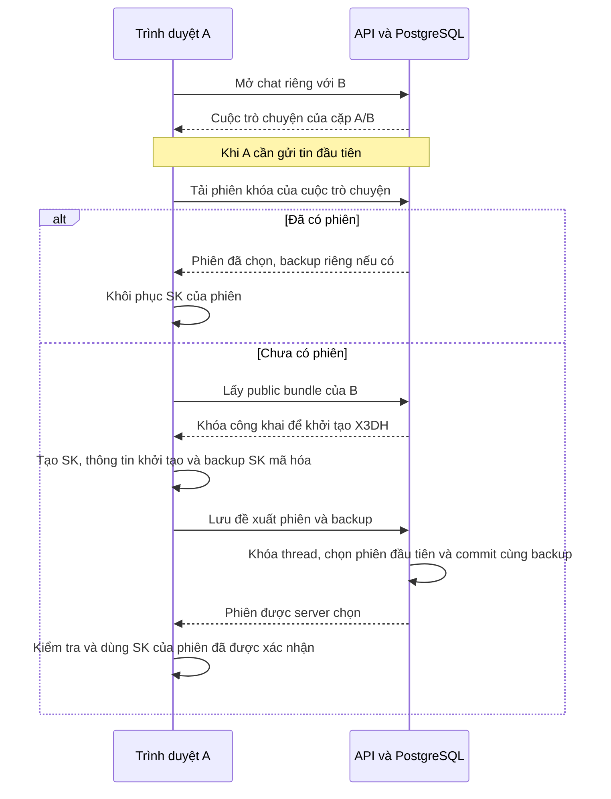

Mỗi direct dùng một phiên cố định trên mọi tab và cả hai chiều. Nếu nhiều client khởi tạo đồng thời, server chọn một phiên; bên thua nhận `409` rồi khôi phục phiên đã chọn. B dùng bộ khóa riêng và thông tin khởi tạo để tính cùng SK. X3DH không chạy lại cho mỗi tin; không có rekey hay Double Ratchet.

### Gửi và nhận tin đã mã hóa

A gửi **“Chào B”** với mã `m2`. Bản mã gọi là **ciphertext**; gói gửi chứa bản mã và thông tin phiên gọi là **envelope**. Luồng này thêm mã hóa trước khi gửi và giải mã sau khi nhận vào đường gửi/nhận đã giải thích với nhóm.

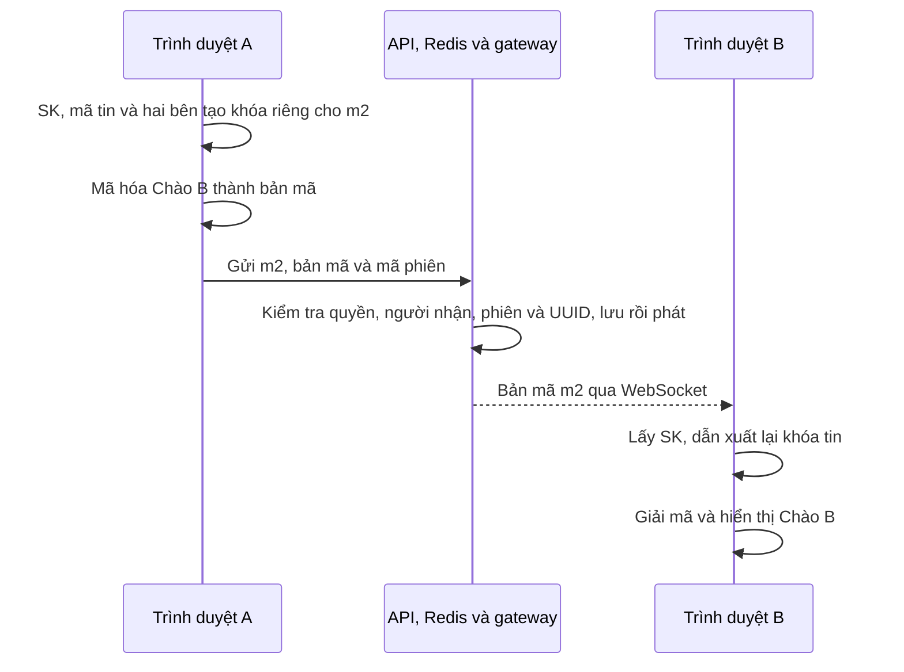

**Context** gắn khóa tin với cuộc trò chuyện, epoch, UUID và hai bên gửi/nhận. HKDF thực hiện dẫn xuất khóa; AES-256-GCM mã hóa và kiểm tra dữ liệu. **Envelope** chứa epoch, recipient, nonce và ciphertext. Retry giữ nguyên UUID và envelope.

WebSocket vẫn phát tới mọi kết nối của A và B, kể cả các tab của người gửi. Các tab gộp tin và lấy bù như nhóm; direct chỉ tăng marker sau khi giải mã thành công. Thông báo đọc của direct gửi cho cả reader và peer, nên A thấy B đã đọc.

### Đồng bộ khóa để đọc trên máy khác

B đăng nhập trên máy mới và tải được bản mã `m2`. Để đọc nó, máy mới còn phải khôi phục đúng SK của phiên. Vì vậy mỗi bên lưu **backup SK đã mã hóa riêng cho tài khoản của mình**.

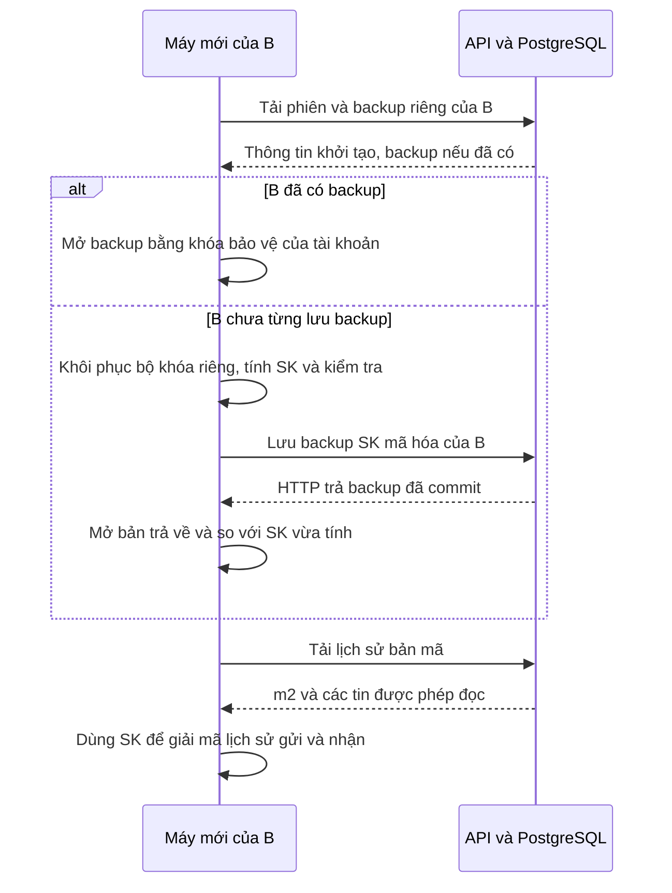

Server chỉ trả backup của chính người gọi và giữ bản ghi đầu tiên. HTTP xác nhận lưu backup ở đây khác ACK của Redis ở luồng realtime. Khóa đã mở và SK nằm trong RAM của client.

Để máy mới mở được backup, tài khoản cần bộ khóa gốc và một cách mở lại chúng bằng mật khẩu. Đó là lý do đăng ký và đăng nhập có thêm vault.

## Đăng ký

**Vault** là bộ khóa riêng dùng cho X3DH của tài khoản, được mã hóa trước khi lưu server. Backup SK của từng cuộc trò chuyện được lưu riêng, bảo vệ bằng khóa dẫn xuất từ khóa mở vault.

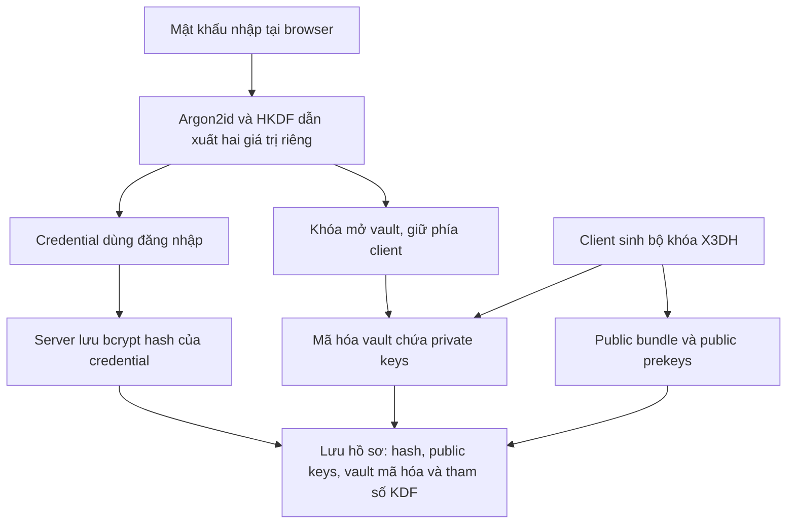

**Credential** là giá trị dẫn xuất để server kiểm tra đăng nhập, không phải mật khẩu gốc. Public keys phục vụ khởi tạo phiên; vault giữ các private keys để phục hồi, kể cả khi public prekey đã được claim. Server lưu thêm salt và tham số KDF để máy mới tạo lại đúng credential/khóa mở vault. Sau đăng ký thành công, web tự đăng nhập bằng credential vừa tạo.

Server đã có hồ sơ tài khoản và dữ liệu khóa mã hóa. Đăng nhập vừa xác thực user, vừa mở lại khóa ở client để thực hiện các bước chat phía trên.

## Đăng nhập và vé WebSocket

KDF là cách tạo khóa từ mật khẩu và **salt**, giá trị ngẫu nhiên của tài khoản được lưu từ lúc đăng ký. Máy mới dùng lại đúng salt và tham số đó.

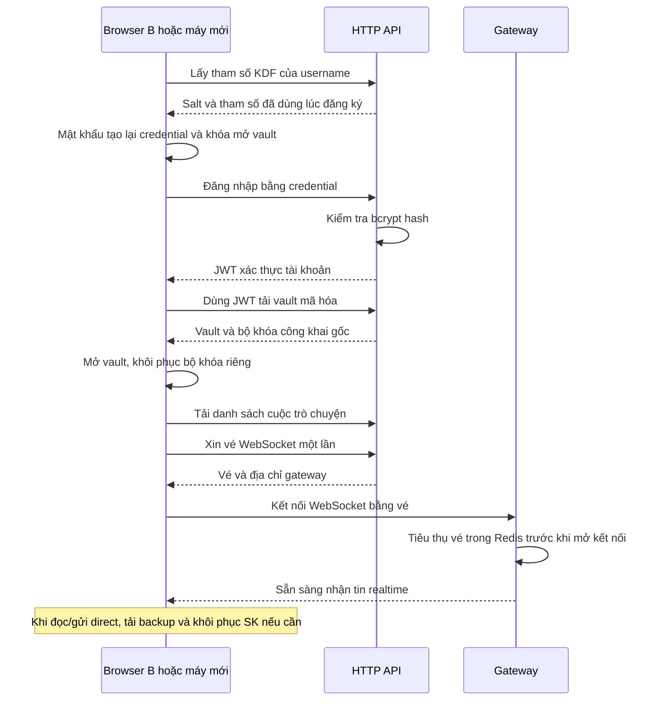

JWT xác thực các request HTTP. Vé WebSocket dùng một lần, mặc định hết hạn sau 30 giây; browser xin vé mới mỗi lần kết nối lại. Các bước đã đủ để B tham gia luồng gửi/nhận và khôi phục lịch sử bằng cùng tài khoản trên nhiều thiết bị.

| Dữ liệu phía client | Nơi lưu |
| --- | --- |
| Private keys đã mở, SK, plaintext và cache tin | RAM của tab |
| JWT, username, user UUID, khóa mở vault để reload cùng phiên | `sessionStorage`, xóa khi đăng xuất |
| UUID/context/envelope/body của tin direct chưa xác nhận | Outbox trong `localStorage`, fallback RAM nếu storage lỗi |

Quên mật khẩu và mất mọi khóa đã mở thì không phục hồi được. Vault và backup phải còn trên server; giữ archive khóa để đọc lịch sử là đánh đổi được nêu trong [ADR 005](adr/005-recoverable-e2ee-sessions.md).

Đối chiếu code và giới hạn triển khai

| Luồng | Điểm đọc code |
| --- | --- |
| Khởi động API / gateway | [`run`](../cmd/main.go), [`run/serve`](../cmd/ws-gateway/main.go) |
| Handler → service → repository | [router](../internal/route/router.go), [`Send`](../internal/module/message/service/service.go), [transaction gửi tin](../internal/module/message/repository/postgres.go) |
| Publish, queue, ACK | [`PublishMessage`](../internal/module/message/service/publish.go), [`handleStreams`](../internal/gateway/consumer.go), [`Dispatch/writeLoop`](../internal/gateway/hub.go) |
| Nhóm và membership | [`CreateGroup/ChangeMember`](../internal/module/thread/repository/groups.go), [queries](../db/queries/groups.sql) |
| Cache thành viên | [`messageRecipients`](../internal/module/message/service/publish.go), [queries tại sequence](../db/queries/messages.sql), [`Redis.Get/Put`](../internal/module/thread/membership/redis.go) |
| Gộp tin, catch-up và read marker | [realtime core](../web/realtime-core.js), [`loadThreads/flushReadMarker`](../web/app.js), [`MarkRead`](../internal/module/thread/service/service.go) |
| Khóa phiên, tin mã hóa và backup | [client E2EE](../web/e2ee.js), [X3DH và backup](../internal/e2ee/epoch.go), [mã hóa tin](../internal/e2ee/messages.go) |
| Đăng ký, đăng nhập và vault | [`DeriveCredentials/EncryptAccountVault`](../internal/e2ee/account.go), [`Register/Login`](../internal/module/user/service/service.go), [lưu tài khoản](../internal/module/user/repository/postgres.go) |
| Dữ liệu client và danh sách user | [outbox](../web/e2ee-state.js), [`cacheSession/clearSession/loadUsers`](../web/app.js) |

- Cache thành viên dùng mốc lớn nhất không vượt seq: `joined_seq` hoặc `left_seq+1`. Redis GET/SET tối đa 100 ms trong tổng publish timeout; lỗi ghi cache chỉ log.
- Publish message lỗi sau commit trả `503`; retry giữ UUID/body. Chưa có transactional outbox backend. Gateway hiện hỗ trợ một instance; queue đầy/kết nối chậm bị đóng để client lấy bù REST. Xem [ADR 001](adr/001-gateway-and-stream.md), [ADR 003](adr/003-message-order.md).
- Nhóm tối đa 100 người, creator là admin. Thêm/xóa/rời sinh tin hệ thống; admin cuối rời thì chuyển cho người còn lại tham gia sớm nhất. Tạo nhóm chưa có idempotency key; lỗi sau commit phải đối chiếu trước khi tạo lại.
- Marker chỉ tăng trong phạm vi membership, unread do server đếm; không bằng hiệu hai sequence. Xem [ADR 002](adr/002-unread-count.md).
- KDF v1: Argon2id, salt 16 byte, 65536 KiB, 3 lượt, parallelism 4, output 32 byte. IK/SPK/OPK là khóa định danh/prekey có chữ ký/prekey dùng một lần. Mỗi tài khoản tạo 20 OPK; direct mới hết public OPK dùng X3DH 3 DH thay vì 4 DH. AES-GCM dùng nonce 12 byte, tag 16 byte.
- UI chưa có đối chiếu fingerprint hoặc đổi mật khẩu. Nút làm mới user chỉ gọi `GET /users` theo thao tác, giữ lựa chọn còn hợp lệ và trạng thái chat. Schema/quyền membership chi tiết: [ERD](chat-api-erd.md). Cách chạy/kiểm tra: [README](../README.md).

